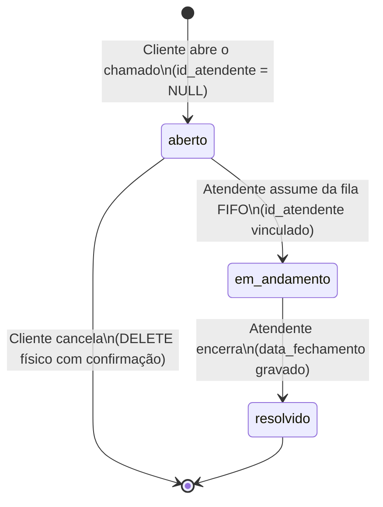

# Contratos de Integração: Chamados e Ciclo de Atendimento (Pessoa 3)

Este documento formaliza as assinaturas, tipos de dados, regras de negócio e contratos de interface para o módulo de **Chamados (Atendimentos)**, sob responsabilidade da **Pessoa 3**, conforme planejado em `docs/planejamento_projeto.md` (tarefa **P3.1**).

---

## 1. Mapeamento Objeto-Relacional (Entidade `Atendimento`)

O modelo de domínio reside em `src/model/atendimentos.py` (`class Atendimento`). Ele é mapeado diretamente para a tabela `chamados` do PostgreSQL:

| Atributo no Python | Coluna no PostgreSQL | Tipo SQL | Restrição / Regra |
| :--- | :--- | :--- | :--- |
| `id_chamado` | `id_chamado` | `INT` | `PRIMARY KEY`, gerada automaticamente (`IDENTITY`) |
| `cliente` / `id_cliente` | `id_cliente` | `INT` | `NOT NULL`, chave estrangeira para `clientes(id_cliente)` |
| `atendente` / `id_atendente` | `id_atendente` | `INT` | `DEFAULT NULL`, chave estrangeira para `atendentes(id_atendente)` |
| `nome` (ou alias `titulo`) | `nome` | `TEXT` | `NOT NULL`, título resumido do chamado |
| `descricao` | `descricao` | `TEXT` | `NOT NULL`, descrição detalhada do problema |
| `data_abertura` | `data_abertura` | `TIMESTAMP` | `DEFAULT CURRENT_TIMESTAMP`, data/hora de abertura |
| `data_fechamento` | `data_fechamento` | `TIMESTAMP` | `DEFAULT NULL`, preenchido apenas na resolução |
| `status` | `status` | `TEXT` | `CHECK (status IN ('aberto', 'em andamento', 'resolvido'))` |

---

## 2. Ciclo de Vida do Chamado e Máquina de Estados



### Regras de Transição de Estado:
1. **`aberto`:** Chamado recém-criado pelo cliente. `id_atendente` é estritamente `None`/`NULL`. Permite exclusão/cancelamento físico pelo titular.
2. **`em andamento`:** Chamado assumido da fila por um atendente. Não pode ser excluído pelo cliente sem intervenção administrativa.
3. **`resolvido`:** Atendimento concluído. `data_fechamento` é preenchido com a data/hora atual. Não pode ser reaberto no escopo da C2.

---

## 3. Contratos da Controladora (`Controller_Atendimento`)

A classe `Controller_Atendimento` em `src/controller/controller_atendimento.py` deve expor as seguintes operações públicas para consumo da interface de linha de comando (Pessoa 4):

### 3.1 Operações do Cliente

#### `criar_chamado(id_cliente: int, titulo: str, descricao: str) -> Atendimento`
- **Entrada:** ID do cliente cadastrado, título não vazio e descrição não vazia.
- **Comportamento:** Cria o registro no banco com status `'aberto'`, `data_abertura = NOW()` e `id_atendente = NULL`.
- **Retorno:** Instância de `Atendimento` populada com o `id_chamado` gerado.
- **Erros:** Dispara `ValueError` se título/descrição forem vazios ou se `id_cliente` for inválido.

#### `listar_chamados_cliente(id_cliente: int, apenas_ativos: bool = True) -> list[Atendimento]`
- **Entrada:** ID do cliente.
- **Comportamento:** Retorna os chamados vinculados ao cliente. Se `apenas_ativos=True`, filtra por `status IN ('aberto', 'em andamento')`.
- **Retorno:** Lista de objetos `Atendimento` (pode ser vazia).

#### `consultar_detalhes(id_chamado: int) -> Atendimento`
- **Entrada:** ID do chamado.
- **Retorno:** Objeto `Atendimento` completo com cliente e atendente associados (se houver).
- **Erros:** Dispara `LookupError` se o chamado não existir.

#### `cancelar_chamado(id_chamado: int, id_cliente: int) -> bool`
- **Entrada:** ID do chamado e ID do cliente solicitante.
- **Comportamento:** Realiza exclusão física (`DELETE`) do chamado.
- **Regra de Proteção:** Exige que o chamado pertença ao `id_cliente` e esteja com `status = 'aberto'`. Se já estiver `'em andamento'` ou `'resolvido'`, a exclusão é recusada.
- **Retorno:** `True` se excluído com sucesso; `False` ou exceção caso o chamado já tenha sido movimentado ou não pertença ao cliente.

---

### 3.2 Operações do Atendente

#### `assumir_proximo_chamado(id_atendente: int) -> Atendimento | None`
- **Entrada:** ID do atendente autenticado na sessão.
- **Comportamento (Fila FIFO Atômica):**
  - Seleciona o chamado com `status = 'aberto'` e `id_atendente IS NULL` com a menor `data_abertura` (desempate por menor `id_chamado`).
  - Atualiza atomicamente no banco para `status = 'em andamento'` e `id_atendente = id_atendente`.
  - Utiliza `SELECT ... FOR UPDATE SKIP LOCKED` para garantir que duas sessões concorrentes de atendentes nunca peguem o mesmo chamado.
- **Retorno:** Objeto `Atendimento` atualizado ou `None` caso a fila esteja vazia.

#### `listar_meus_chamados(id_atendente: int) -> list[Atendimento]`
- **Entrada:** ID do atendente autenticado.
- **Comportamento:** Retorna a lista de chamados sob responsabilidade desse atendente com status `'em andamento'`.
- **Retorno:** Lista de objetos `Atendimento`.

#### `listar_historico_atendente(id_atendente: int) -> list[Atendimento]`
- **Entrada:** ID do atendente autenticado.
- **Comportamento:** Retorna todos os chamados com status `'resolvido'` cujo responsável seja o atendente informado.
- **Retorno:** Lista de objetos `Atendimento` ordenados por `data_fechamento DESC`.

#### `resolver_chamado(id_chamado: int, id_atendente: int) -> Atendimento`
- **Entrada:** ID do chamado e ID do atendente autenticado.
- **Comportamento:**
  - Valida se o chamado está `'em andamento'` e pertence ao `id_atendente`.
  - Atualiza para `status = 'resolvido'` e preenche `data_fechamento = CURRENT_TIMESTAMP`.
- **Retorno:** Objeto `Atendimento` atualizado.
- **Erros:** Dispara `PermissionError` se o chamado pertencer a outro atendente ou `ValueError` se o status não for `'em andamento'`.

---

### 3.3 Manutenção Acadêmica (CRUD para Edital)

#### `listar_todos(ordem: str = "id") -> list[Atendimento]`
- **Comportamento:** Lista todos os chamados do sistema para seleção prévia com chave e descrição no menu de manutenção.

#### `atualizar_chamado(id_chamado: int, titulo: str, descricao: str) -> Atendimento`
- **Comportamento:** Atualiza título e descrição sem alterar chaves primárias ou violar o ciclo de status.

#### `excluir_chamado_admin(id_chamado: int) -> bool`
- **Comportamento:** Exclusão física para o menu de manutenção administrativa do edital com confirmação prévia.

---

## 4. Garantia de Concorrência na Fila FIFO

Para evitar *race conditions* (quando dois atendentes clicam em "Assumir chamado" simultaneamente e recebem o mesmo chamado), a consulta no PostgreSQL é executada em bloco atômico utilizando subselect protegido:

```sql
UPDATE chamados
SET id_atendente = %s, status = 'em andamento'
WHERE id_chamado = (
    SELECT id_chamado
    FROM chamados
    WHERE status = 'aberto' AND id_atendente IS NULL
    ORDER BY data_abertura ASC, id_chamado ASC
    LIMIT 1
    FOR UPDATE SKIP LOCKED
)
RETURNING id_chamado, id_cliente, id_atendente, nome, descricao, data_abertura, data_fechamento, status;
```

Essa construção garante:
1. **Ordem determinística (FIFO):** O chamado mais antigo é sempre atendido primeiro.
2. **Desempate estrito:** Se dois chamados forem abertos no mesmo milissegundo, o menor `id_chamado` desempata.
3. **Isolamento de sessão:** `SKIP LOCKED` faz com que um segundo atendente simultâneo pule o registro já bloqueado pelo primeiro e pegue o próximo da fila sem travar a aplicação.
