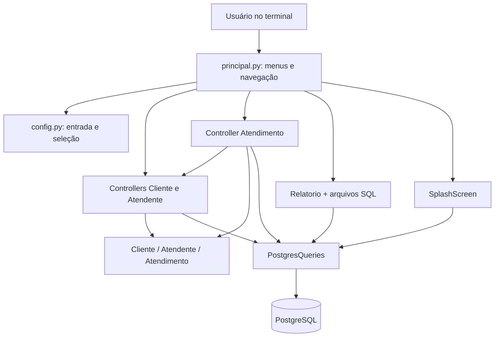
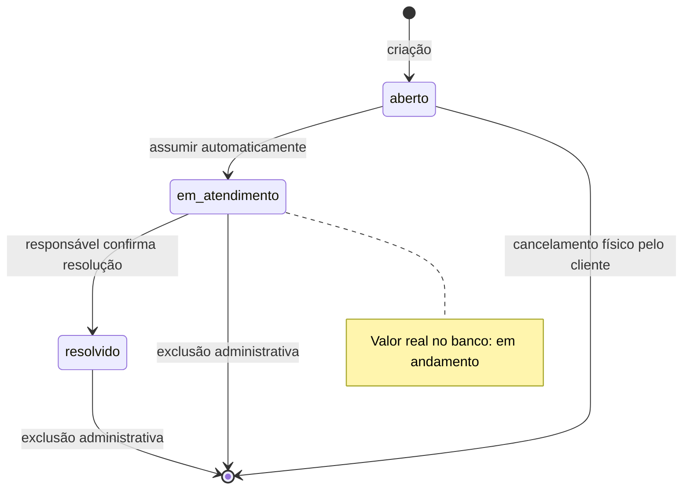

# Documentação técnica avançada — Sistema de Atendimento

Versão analisada: **base_integrada**, em 30/10/2026. Este manual descreve o código local integrado de Ricardo e Davi, não as cópias da raiz ou base_exemplo. Não foi criado um novo schema nem alterado o comportamento da aplicação para produzir esta documentação.

O inventário e as assinaturas foram conferidos por análise sintática dos arquivos. Descrições de execução são leitura do código: não significam que todos os cenários foram novamente executados nesta tarefa. Os registros anteriores de validação são tratados separadamente dos contratos atuais.

## Sumário

1. [Arquitetura e responsabilidades](#arquitetura-e-responsabilidades)
2. [Fluxos completos](#fluxos-completos)
3. [Configuração e inicialização](#configuração-e-inicialização)
4. [Modelo persistido e regras](#modelo-persistido-e-regras)
5. [Transações, concorrência e falhas](#transações-concorrência-e-falhas)
6. [Inventário de todos os arquivos](#inventário-de-todos-os-arquivos)
7. [Catálogo de funções e métodos](#catálogo-de-funções-e-métodos)
8. [Limitações e manutenção](#limitações-e-manutenção)

## Arquitetura e responsabilidades

A aplicação é uma CLI síncrona, com conexão direta dos controllers ao PostgreSQL por Psycopg 2. Não há ORM, API HTTP, repositório intermediário ou serviço web. A arquitetura mantém o estilo do exemplo original: funções de navegação no principal, controllers por entidade, modelos com getters/setters e uma classe compartilhada de consultas. Alguns controllers também conduzem seus próprios formulários, portanto interface e persistência não estão completamente separadas.

A associação de um chamado a Cliente/Atendente é montada em Python após a consulta do chamado. Isso difere dos relatórios: o relatório detalhado faz JOIN no próprio SQL. Os modelos são fotografias em memória, não entidades com carregamento automático; setters não geram UPDATE e getters não buscam alterações recentes.

Os controllers de identidade montam modelos a partir de DataFrames. O controller de atendimento usa linhas do cursor e adiciona associações com outros controllers. A coexistência dessas estratégias é parte da integração atual.

## Fluxos completos

### Abertura pelo cliente

1. run encaminha a opção 1 para abrir_chamado.
2. identificar_cliente solicita email validado e chama buscar_por_email.
3. Se não houver cliente, coleta nome e telefone, permite retorno ao email e confirma o cadastro. A inclusão usa os dados explícitos, sem exigir operador administrativo.
4. abrir_chamado solicita título e descrição e confirma em 1/0.
5. criar_chamado valida o cliente, insere aberto, obtém a linha e monta as associações. A transação confirma antes de o objeto retornar à tela.

Cadastro e abertura são transações diferentes: um cliente recém-criado permanece mesmo que a pessoa desista do chamado. Não há INSERT durante o preenchimento incompleto do cadastro.

### Consulta e cancelamento

consultar identifica cliente, consulta todos os seus chamados para distinguir ausência de registros de ausência de abertos e filtra somente aberto para a seleção. Depois de selecionar, relê os detalhes e confere id_cliente. O DELETE só ocorre após confirmação 1/0 e exige no controller id, titular, estado aberto e ausência de atendente. Se outra sessão assumir antes, o DELETE não remove a linha. Cancelamento é exclusão física: não cria estado cancelado nem registro histórico.

### Login, fila e encerramento

O login usa email e senha visível; a comparação é direta com o texto persistido. O objeto Atendente retornado não leva a senha. O principal conserva esse objeto localmente e recarrega a conta pelo id antes de cada menu. 0 encerra a sessão local; não há sessão persistida ou token.

Assumir executa a atualização atômica do candidato aberto sem atendente mais antigo disponível. Meus chamados seleciona em andamento do operador, relê o registro e oferece resolução confirmada; resolver confere titularidade novamente no banco e grava resolvido/fechamento. Histórico consulta apenas resolvidos associados ao operador atual, com detalhes, sem permitir nova resolução. A função auxiliar assumir existe, mas o login atual chama o controller diretamente.

### Manutenção e relatórios

O menu do atendente oferece a opção de manutenção; entrar nela exige autorização, e os controllers verificam novamente a permissão antes do CRUD. A autorização consulta o email atual pelo id e compara com MANUTENCAO_EMAILS; mudar o email no banco pode conceder ou revogar acesso na próxima checagem. Os formulários administrativos usam confirmar s/N. Chamadas diretas a métodos de exclusão por id não solicitam confirmação.

Relatórios ficam na navegação autenticada, mas a classe Relatorio não exige operador em seus métodos. A conexão termina antes de imprimir o DataFrame e aguardar Enter. exibir=False permite obter os dados sem entrada interativa.

## Configuração e inicialização

| Elemento | Uso e precedência |
| --- | --- |
| DB_HOST / DB_PORT | Destino; padrões localhost/5432 na classe de conexão. Porta precisa ser numérica. |
| DB_NAME / DB_USER / DB_PASSWORD | Banco/usuário/senha; banco e usuário têm padrão postgres. Não reproduzir a configuração real em documentação. |
| MANUTENCAO_EMAILS | Lista separada por vírgulas, sem diferença de maiúsculas; vazia nega manutenção para todos. |
| .env | Localizado pela pasta da aplicação, sem depender do diretório do terminal; override=False preserva ambiente já definido. |
| --env-file | Argumento do principal: valida o caminho e carrega com override=True antes de run. A leitura posterior do .env padrão pode suprir chaves que o arquivo alternativo não definiu. |

Instanciar PostgresQueries não conecta. connect abre a sessão sob demanda. O principal instancia controllers e splash, mas a primeira leitura efetiva acontece nas contagens da splash. Sem banco/tabelas disponíveis, a aplicação informa falha e não chega aos menus.

O bloco executável de principal usa argparse para --env-file e trata EOFError/KeyboardInterrupt. Não há modo de demonstração em memória ativo. scripts/criar_atendente_demo.py e src/create_tables_and_records.py têm seus próprios blocos de execução; importar esses módulos não deve disparar seus run.

O instalador só deve ser usado no banco vazio: executa o DDL e depois a carga em transações independentes, sem IF NOT EXISTS/migração. Uma carga que falha não desfaz a criação já confirmada. A divisão por ponto e vírgula atende os arquivos atuais simples; não é uma infraestrutura genérica para SQL com corpos complexos.

## Modelo persistido e regras

| Tabela | Responsabilidade | Garantias existentes |
| --- | --- | --- |
| clientes | Identificação do cliente e contato | Identidade inteira, nome/email/telefone obrigatórios e email único. |
| atendentes | Identificação, contato e autenticação | Mesmas garantias de contato, mais senha textual obrigatória. |
| chamados | Demanda, cliente, responsável, datas e estado | Identidade, FK cliente obrigatória, FK atendente opcional, nome/descrição obrigatórios, status obrigatório com CHECK dos três valores. |

O nome SQL do título é nome. Atendimento oferece get_titulo/set_titulo como aliases; não existe coluna titulo separada. A criação usa status aberto. A atribuição define em andamento e responsável; a resolução define resolvido e data de fechamento.

A manutenção pode remover qualquer estado, inclusive aberto. Não há reabertura, transferência ou estado cancelado no fluxo. Não há exclusão em cascata: referências de chamados impedem remover clientes/atendentes associados.

O schema não garante todas as combinações de estado/responsável/datas. data_abertura tem padrão current_timestamp, mas aceita NULL; datas são timestamp sem fuso. Não existe CHECK cronológico de fechamento ou CHECK impondo atendente quando em andamento. As operações de domínio preservam essas regras em seus caminhos; SQL externo pode produzir dados incoerentes.

Email recebe validação sintática básica, strip e casefold no controller. A unicidade declarada é textual; registros externos com variantes de caixa podem tornar busca/autenticação ambígua e são recusados por esses métodos. Telefone continua string e aceita sinais usuais com ao menos um dígito, sem validação completa de DDD/tamanho. Senha só exige string não vazia: espaços externos são preservados, e o armazenamento/comparação diretos seguem a decisão atual do projeto.

### Carga e relatórios

A carga é fixa, não aleatória: Ana/Bruno, Carla/Diego, um chamado aberto sem atendente e outro resolvido por Carla com intervalo de uma hora. Nenhum chamado começa em andamento; é preciso assumir o aberto para demonstrar essa etapa. As credenciais fictícias são públicas na carga/README e não representam as credenciais do .env.

O relatório de média usa diferença fechamento menos abertura em segundos, não tempo desde a atribuição, tempo útil ou SLA. Só considera resolvidos com ambas as datas e fechamento maior ou igual à abertura. O filtro fica no JOIN para manter atendentes sem amostra: quantidade zero e média NULL. A apresentação troca nulos por texto apenas na cópia visual; o DataFrame retornado mantém o resultado da consulta.

## Transações, concorrência e falhas

write confirma automaticamente fora de transaction; dentro dela, a confirmação fica para a saída normal. O contexto não aceita aninhamento e desfaz quando uma exceção sai do bloco. Um return dentro de with não ignora o commit. A flag can_write é controle de uso da classe; não é permissão do servidor. Consultas e cursor direto exigem a mesma disciplina e privilégios efetivos do usuário PostgreSQL.

A fila combina escolha e UPDATE na mesma transação. FOR UPDATE SKIP LOCKED impede que duas sessões assumam o mesmo candidato e pula linhas já bloqueadas. A ordem abertura/id é FIFO entre candidatos disponíveis; um chamado antigo bloqueado pode ser atendido depois de outro mais recente livre. Se todos os candidatos estiverem bloqueados, a consulta pode retornar nenhum naquele instante.

Resolver e cancelar incluem filtros de domínio também na mutação. A leitura anterior ajuda a explicar o erro, mas não é usada sozinha como garantia contra corrida. Objetos associados são carregados em sessões separadas; esses nomes/dados não pertencem necessariamente à mesma fotografia da transação do chamado.

| Situação | Convenção efetiva |
| --- | --- |
| Cliente/atendente ausente por id | LookupError. |
| Cliente/atendente ausente por email | None. |
| Detalhes de chamado ausente | None, apesar da anotação não opcional. |
| Fila sem candidato ou atendente inexistente | None; mensagem diferencia o segundo caso no controller. |
| Cancelamento impedido | False, com mensagens em parte dos caminhos. |
| Atualização textual de chamado inválida/ausente | None e mensagem; wrapper interativo converte em RuntimeError. |
| Resolução não autorizada/estado inválido | PermissionError / RuntimeError. |
| Duplicidade do driver | RuntimeError traduzido, com causa. |
| Violação de FK do driver | ValueError traduzido. |
| Outros erros do driver | ConnectionError traduzido, inclusive problemas SQL que não são queda de rede. |
| Retorno administrativo | Voltar, exceção sem conteúdo adicional. |
| Retorno do seletor público | None; confirmação pública usa 1/0. |

Conexões próprias são fechadas em finally. No controller de atendimento, uma conexão injetada pertence ao chamador e não é fechada pelo método. Os controllers de identidade associados continuam usando suas próprias sessões, mesmo quando chamados recebe uma conexão injetada. Evitar tratar os métodos como se todos compartilhassem um único contrato de ausência ou confirmação.

## Inventário de todos os arquivos

O inventário cobre **49 arquivos**, incluindo configurações locais, pacotes vazios, SQL, artefatos visuais e documentos. Arquivos temporários e caches Python não fazem parte da arquitetura. A cópia não contém diretório de testes ativo.

| Arquivo | Responsabilidade e leitura correta |
| --- | --- |
| `.env` | Configuração local efetiva de conexão/autorização. Não é reproduzida neste documento nem deve ser publicada; copiar código não isola o banco se as configurações apontarem para o mesmo destino. |
| [.env.example](../.env.example) | Modelo das variáveis DB_HOST, DB_PORT, DB_NAME, DB_USER, DB_PASSWORD e MANUTENCAO_EMAILS para instalação em outra máquina. |
| [LICENSE](../LICENSE) | Condições de licenciamento distribuídas com o projeto; não participa da execução. |
| [README.md](../README.md) | Entrada de uso, instalação, integrantes, histórico de integração e pendências acadêmicas. Contém registros de validações de versões anteriores. |
| [diagrams/diagrama_relacional_atendimento.mmd](../diagrams/diagrama_relacional_atendimento.mmd) | Fonte Mermaid do diagrama relacional para edição/documentação. |
| [diagrams/exportados/.gitkeep](../diagrams/exportados/.gitkeep) | Marcador de versionamento do diretório; não afeta a aplicação. |
| [diagrams/exportados/diagrama_relacional_atendimento.png](../diagrams/exportados/diagrama_relacional_atendimento.png) | Imagem exportada do diagrama para leitura e entrega; revisar fonte e exportação juntas quando o modelo mudar. |
| [docs/checklist_entrega.md](../docs/checklist_entrega.md) | Lista de conferência acadêmica e operacional para o grupo. |
| [docs/contratos_componentes.md](../docs/contratos_componentes.md) | Contratos de referência/histórico da base; contém aviso sobre nomes alterados na integração. Conferir assinaturas atuais neste manual. |
| [docs/contribuicoes_originais/davi/contratos_cli.md](../docs/contribuicoes_originais/davi/contratos_cli.md) | Contrato original preservado da branch Davi; pode mencionar provider/arquitetura que não foram transportados integralmente. |
| [docs/contribuicoes_originais/ricardo/contratos_chamados.md](../docs/contribuicoes_originais/ricardo/contratos_chamados.md) | Contrato original preservado da branch Ricardo; ler com as adaptações descritas na integração. |
| [docs/documentacao_tecnica_avancada.md](../docs/documentacao_tecnica_avancada.md) | Este manual: inventário, arquitetura, contratos e catálogo de todas as funções da base_integrada no estado analisado. |
| [docs/entrega_projeto.md](../docs/entrega_projeto.md) | Preparação da entrega, responsáveis, execução e itens ainda externos ao código. |
| [docs/integracao_branches.md](../docs/integracao_branches.md) | Registro das branches de origem, adaptações da integração e evidências da validação integrada. |
| [docs/integracao_manifesto.json](../docs/integracao_manifesto.json) | Metadados de proveniência e hashes selecionados de origem/destino; inclui última remoção de comentários. Não é importado pela aplicação. |
| [docs/limpeza_legado.md](../docs/limpeza_legado.md) | Registro histórico da remoção dos artefatos antigos; não é descrição completa da implementação corrente. |
| [docs/matriz_aceite_etapa_7.md](../docs/matriz_aceite_etapa_7.md) | Matriz histórica de cenários e resultados anteriores à integração atual; testes citados foram removidos. |
| [docs/padrao_codigo.md](../docs/padrao_codigo.md) | Referência de estilo/organização. Orientações históricas sobre comentários devem ser lidas junto da remoção posterior solicitada. |
| [docs/refatoracao_arquitetura_original.md](../docs/refatoracao_arquitetura_original.md) | Comparação histórica com a arquitetura de exemplo e justificativa das adaptações para PostgreSQL. |
| [docs/roteiro_video.md](../docs/roteiro_video.md) | Sequência sugerida para gravação da demonstração, não executada automaticamente. |
| [docs/validacao_etapas_5_6.md](../docs/validacao_etapas_5_6.md) | Evidências históricas das etapas de CLI/relatórios, anteriores às alterações posteriores. |
| [docs/validacao_vm.md](../docs/validacao_vm.md) | Roteiro e aceite manual na VM Linux; não é evidência de que a VM já foi validada. |
| [project_spec.md](../project_spec.md) | Especificação e etapas planejadas. É referência de requisitos e não substitui a leitura do comportamento implementado após integrações. |
| [scripts/criar_atendente_demo.py](../scripts/criar_atendente_demo.py) | Redefine a senha da conta fictícia Carla já existente. Operação de demonstração, não chamada na inicialização normal. |
| [sql/create_tables_atendimento.sql](../sql/create_tables_atendimento.sql) | DDL canônico das três tabelas, identidades, chaves, referências, obrigatoriedade, emails únicos e CHECK de status. |
| [sql/inserting_samples_atendimento.sql](../sql/inserting_samples_atendimento.sql) | Carga determinística de dois clientes, dois atendentes e dois chamados: um aberto e um resolvido; nenhum em andamento inicialmente. |
| [src/conexion/__init__.py](../src/conexion/__init__.py) | Arquivo vazio que marca o pacote Python conexion; não define funções, inicialização ou SQL executável. |
| [src/conexion/postgres_queries.py](../src/conexion/postgres_queries.py) | Sessão PostgreSQL, cursor, consultas parametrizadas, DataFrame/matriz/JSON, escrita, contexto transacional e tradução de erros. |
| [src/controller/__init__.py](../src/controller/__init__.py) | Arquivo vazio que marca o pacote Python controller; não define funções, inicialização ou SQL executável. |
| [src/controller/controller_atendente.py](../src/controller/controller_atendente.py) | CRUD, validações, autenticação por senha direta e autorização de manutenção por lista local de emails. |
| [src/controller/controller_atendimento.py](../src/controller/controller_atendimento.py) | Persistência/associação de chamados, fila concorrente, resolução, cancelamento, histórico e formulários administrativos. Integra a contribuição de Ricardo. |
| [src/controller/controller_cliente.py](../src/controller/controller_cliente.py) | Validação e CRUD de clientes, autorização administrativa e formulários; cadastro público por dados explícitos e leitura por email/id. |
| [src/create_tables_and_records.py](../src/create_tables_and_records.py) | Instalador de tabelas e dados fictícios, com criação e carga em transações separadas; não é inicializador automático nem migrador. |
| [src/model/__init__.py](../src/model/__init__.py) | Arquivo vazio que marca o pacote Python model; não define funções, inicialização ou SQL executável. |
| [src/model/atendentes.py](../src/model/atendentes.py) | Modelo público Atendente em memória; senha fica fora deste objeto e das consultas públicas. |
| [src/model/atendimentos.py](../src/model/atendimentos.py) | Modelo Atendimento com identificadores, textos, datas, status e associações opcionais de cliente/atendente; título é alias de nome. |
| [src/model/clientes.py](../src/model/clientes.py) | Modelo Cliente em memória: id, nome, email, telefone, acesso e apresentação textual; não faz persistência. |
| [src/principal.py](../src/principal.py) | Ponto de entrada executável, menus e fluxos públicos/autenticados, adaptação de dados e despacho das ações. Não existe classe Aplicacao ativa nem módulo cli nesta cópia. |
| [src/reports/__init__.py](../src/reports/__init__.py) | Arquivo vazio que marca o pacote Python reports; não define funções, inicialização ou SQL executável. |
| [src/reports/relatorios.py](../src/reports/relatorios.py) | Leitura dos arquivos SQL e geração/apresentação de quatro relatórios DataFrame; contagens auxiliares. |
| [src/requirements.txt](../src/requirements.txt) | Dependências: psycopg2-binary, python-dotenv, pandas e NumPy, com faixas de versões. NumPy não tem import direto no código atual. |
| [src/sql/__init__.py](../src/sql/__init__.py) | Arquivo vazio que marca o pacote Python sql; não define funções, inicialização ou SQL executável. |
| [src/sql/relatorio_atendentes.sql](../src/sql/relatorio_atendentes.sql) | Lista atendentes por nome/id sem selecionar senha. |
| [src/sql/relatorio_atendimentos_detalhados.sql](../src/sql/relatorio_atendimentos_detalhados.sql) | INNER JOIN com cliente e LEFT JOIN com atendente para manter chamados sem responsável no resultado; ordena abertura/id. |
| [src/sql/relatorio_clientes.sql](../src/sql/relatorio_clientes.sql) | Lista clientes por nome/id com dados públicos. |
| [src/sql/relatorio_tempo_medio_por_atendente.sql](../src/sql/relatorio_tempo_medio_por_atendente.sql) | LEFT JOIN conserva atendentes sem amostra, COUNT identifica quantidade e AVG calcula segundos entre abertura e fechamento de resolvidos com datas válidas. |
| [src/utils/__init__.py](../src/utils/__init__.py) | Arquivo vazio que marca o pacote Python utils; não define funções, inicialização ou SQL executável. |
| [src/utils/config.py](../src/utils/config.py) | Constantes de menus/consultas e primitivas de entrada, confirmação e seleção; exceção Voltar. Mantém helpers administrativos e os integrados de Davi. |
| [src/utils/splash_screen.py](../src/utils/splash_screen.py) | Arte textual, identificação da equipe/disciplina e contagens iniciais com acesso de leitura ao banco. |

## Catálogo de funções e métodos

São **140 funções e métodos**, contados diretamente na árvore sintática. Cada entrada mostra a assinatura do código analisado, o arquivo e a linha inicial. O tipo anotado expressa intenção, não validação automática; os desvios observados estão descritos. Não há funções definidas em SQL nos arquivos atuais.

### src/conexion/postgres_queries.py

Sessão PostgreSQL, cursor, consultas parametrizadas, DataFrame/matriz/JSON, escrita, contexto transacional e tradução de erros.

#### 001 — PostgresQueries.__init__

**Assinatura:** `PostgresQueries.__init__(self, can_write: bool=False)`. [Fonte](../src/conexion/postgres_queries.py#L12).

- **Lógica:** Inicializa estado de conexão/transação e carrega o .env da pasta da aplicação com override=False. Lê host, porta, usuário, senha, banco e can_write.
- **Retorno e efeitos:** Objeto configurado sem conexão. Variáveis de ambiente já definidas prevalecem.
- **Falhas e cuidados:** Porta não numérica gera ConnectionError. Os valores padrão não garantem existência do banco.

#### 002 — PostgresQueries.__del__

**Assinatura:** `PostgresQueries.__del__(self)`. [Fonte](../src/conexion/postgres_queries.py#L27).

- **Lógica:** Tenta liberar recursos durante a coleta do objeto, ignorando exceções do encerramento.
- **Retorno e efeitos:** Nenhum dado retornado; defesa adicional.
- **Falhas e cuidados:** Coleta não é determinística; consumidores ainda precisam de close no finally.

#### 003 — PostgresQueries.connect

**Assinatura:** `PostgresQueries.connect(self)`. [Fonte](../src/conexion/postgres_queries.py#L33).

- **Lógica:** Reutiliza sessão/cursor se ambos abertos; caso contrário limpa o estado, conecta com timeout de 10 segundos e cria cursor.
- **Retorno e efeitos:** Retorna cursor, guardando conexão em conn e cursor em cur.
- **Falhas e cuidados:** Traduz erro do driver. Se criar cursor falhar, fecha a conexão recém-aberta.

#### 004 — PostgresQueries._execute

**Assinatura:** `PostgresQueries._execute(self, query: str, params=None, commit: bool=False)`. [Fonte](../src/conexion/postgres_queries.py#L60).

- **Lógica:** Exige sessão/cursor abertos, executa query com params separados e confirma somente com commit=True fora de transaction.
- **Retorno e efeitos:** Não busca linhas nem retorna dados.
- **Falhas e cuidados:** Erro SQL fora de transação explícita provoca rollback imediato. Dentro do bloco, a exceção traduzida faz o contexto desfazer.

#### 005 — PostgresQueries.transaction

**Assinatura:** `PostgresQueries.transaction(self)`. **Decorador:** `@contextmanager`. [Fonte](../src/conexion/postgres_queries.py#L76).

- **Lógica:** Gerenciador de contexto: exige escrita permitida e conexão aberta, recusa aninhamento, ativa flag e confirma na saída normal.
- **Retorno e efeitos:** Agrupa operações; write não confirma individualmente. Return normal dentro do bloco também passa pelo commit antes de devolver resultado.
- **Falhas e cuidados:** Qualquer BaseException desfaz; erro do driver é traduzido. A flag é limpa em finally. Erro de domínio suprimido dentro do bloco não é automaticamente percebido como falha pelo contexto.

#### 006 — PostgresQueries.sqlToDataFrame

**Assinatura:** `PostgresQueries.sqlToDataFrame(self, query: str, params=None) -> DataFrame`. [Fonte](../src/conexion/postgres_queries.py#L97).

- **Lógica:** Executa, busca todas as linhas e transforma resultado em DataFrame com colunas minúsculas.
- **Retorno e efeitos:** Retorna pandas.DataFrame, inclusive vazio com colunas; não confirma escrita por si.
- **Falhas e cuidados:** Requer comando com resultado/descrição. Não impõe tecnicamente SQL somente de leitura.

#### 007 — PostgresQueries.sqlToMatrix

**Assinatura:** `PostgresQueries.sqlToMatrix(self, query: str, params=None) -> tuple`. [Fonte](../src/conexion/postgres_queries.py#L103).

- **Lógica:** Executa, transforma cada linha em lista e coleta os nomes das colunas.
- **Retorno e efeitos:** Retorna tupla (matriz_de_linhas, nomes_das_colunas).
- **Falhas e cuidados:** Materializa tudo em memória; requer resultado de consulta.

#### 008 — PostgresQueries.sqlToJson

**Assinatura:** `PostgresQueries.sqlToJson(self, query: str, params=None) -> str`. [Fonte](../src/conexion/postgres_queries.py#L111).

- **Lógica:** Combina colunas e valores em dicionários e serializa a lista com Unicode preservado e default=str.
- **Retorno e efeitos:** Retorna string JSON; tipos não nativos, como datas, usam conversão textual.
- **Falhas e cuidados:** Não define por si um formato de datas com fuso; não retorna um objeto Python já desserializado.

#### 009 — PostgresQueries.write

**Assinatura:** `PostgresQueries.write(self, query: str, params=None)`. [Fonte](../src/conexion/postgres_queries.py#L118).

- **Lógica:** Exige can_write=True e pede execução com commit; transaction adia a confirmação quando ativo.
- **Retorno e efeitos:** Retorna rowcount. INSERT RETURNING pode ser lido pelo cursor depois, preferencialmente no bloco transacional.
- **Falhas e cuidados:** A flag é lógica da classe, não substitui privilégios PostgreSQL nem bloqueia acesso direto ao cursor.

#### 010 — PostgresQueries.close

**Assinatura:** `PostgresQueries.close(self)`. [Fonte](../src/conexion/postgres_queries.py#L125).

- **Lógica:** Fecha cursor e conexão com finally, colocando ambas as referências em None.
- **Retorno e efeitos:** Libera recursos e permite chamadas repetidas.
- **Falhas e cuidados:** Não executa commit. Escrita pendente não confirmada não deve ser considerada persistida; falha de fechamento não é traduzida aqui.

#### 011 — PostgresQueries.executeDDL

**Assinatura:** `PostgresQueries.executeDDL(self, query: str, params=None)`. [Fonte](../src/conexion/postgres_queries.py#L137).

- **Lógica:** Encaminha DDL e parâmetros para write.
- **Retorno e efeitos:** Retorno implícito None: não repassa rowcount.
- **Falhas e cuidados:** Herda permissão, transação e erros de write.

#### 012 — PostgresQueries._informar_erro

**Assinatura:** `PostgresQueries._informar_erro(self, erro)`. [Fonte](../src/conexion/postgres_queries.py#L141).

- **Lógica:** Distingue UniqueViolation e ForeignKeyViolation; demais falhas do driver recebem mensagem genérica de banco.
- **Retorno e efeitos:** Sempre lança exceção nativa, preservando a causa original.
- **Falhas e cuidados:** RuntimeError para duplicidade, ValueError para FK e ConnectionError para o restante. Erro de SQL/tabela ausente também pode ser traduzido como ConnectionError, não apenas rede.

### src/controller/controller_atendente.py

CRUD, validações, autenticação por senha direta e autorização de manutenção por lista local de emails.

#### 013 — Controller_Atendente.__init__

**Assinatura:** `Controller_Atendente.__init__(self)`. [Fonte](../src/controller/controller_atendente.py#L10).

- **Lógica:** Define as colunas públicas da entidade. Não lê nem guarda senha no modelo.
- **Retorno e efeitos:** Instância pronta, sem conexão aberta.
- **Falhas e cuidados:** Não faz SQL nesta etapa.

#### 014 — Controller_Atendente.inserir_atendente

**Assinatura:** `Controller_Atendente.inserir_atendente(self, nome=None, email=None, telefone=None, senha=None, operador=None) -> Atendente`. [Fonte](../src/controller/controller_atendente.py#L13).

- **Lógica:** Exige autorização em qualquer caminho. Sem nome solicita nome, email, telefone e senha visível. Valida, verifica email, insere com RETURNING e relê DataFrame na transação para construir o objeto.
- **Retorno e efeitos:** Retorna Atendente e imprime após confirmação da transação; identidade é gerada no banco. Senha é texto direto e não entra no objeto.
- **Falhas e cuidados:** ValueError em dados inválidos, RuntimeError em duplicidade. SQL pode traduzir referência/indisponibilidade. Fecha a conexão no finally; a busca prévia não substitui a restrição de unicidade do banco.

#### 015 — Controller_Atendente.atualizar_atendente

**Assinatura:** `Controller_Atendente.atualizar_atendente(self, id_atendente=None, operador=None, nome=None, email=None, telefone=None, senha=None) -> Atendente`. [Fonte](../src/controller/controller_atendente.py#L41).

- **Lógica:** Exige autorização. Sem id, lista, seleciona e pede atributo; com id/dados, opera diretamente. Valida os campos, confere email/existência e monta UPDATE somente com colunas permitidas. Relê DataFrame e cria objeto na mesma transação.
- **Retorno e efeitos:** Retorna Atendente atualizado e imprime; não modifica a chave. Permite trocar senha preservando caracteres.
- **Falhas e cuidados:** ValueError sem campos/entrada inválida, LookupError se ausente, RuntimeError em email já usado. A interface não pede confirmação extra de atualização. Fecha a conexão.

#### 016 — Controller_Atendente.excluir_atendente

**Assinatura:** `Controller_Atendente.excluir_atendente(self, id_atendente=None, operador=None) -> Atendente | None`. [Fonte](../src/controller/controller_atendente.py#L95).

- **Lógica:** Exige autorização. Sem id, lista e confirma s/N; com id explícito não pede confirmação. Verifica existência, bloqueia a linha com FOR UPDATE, constrói o objeto anterior e executa DELETE na transação.
- **Retorno e efeitos:** Retorna Atendente removido e imprime; confirmação negativa retorna None.
- **Falhas e cuidados:** LookupError se ausente, ValueError em referência impeditiva. Não exclui chamados em cascata. Chamador direto deve controlar a confirmação. Fecha conexão.

#### 017 — Controller_Atendente.verifica_existencia_atendente

**Assinatura:** `Controller_Atendente.verifica_existencia_atendente(self, postgres: PostgresQueries, id_atendente: int=None, email: str=None) -> bool`. [Fonte](../src/controller/controller_atendente.py#L120).

- **Lógica:** Usa conexão já aberta. Email informado tem prioridade e usa lower; caso contrário valida id e consulta. Examina se o DataFrame está vazio.
- **Retorno e efeitos:** True significa registro existente. False significa ausente. Não devolve modelo nem fecha a conexão do chamador.
- **Falhas e cuidados:** Valida id/email, mas não recusa múltiplos registros ambíguos: o propósito aqui é apenas existência.

#### 018 — Controller_Atendente.buscar_por_id

**Assinatura:** `Controller_Atendente.buscar_por_id(self, id_atendente: int) -> Atendente`. [Fonte](../src/controller/controller_atendente.py#L130).

- **Lógica:** Abre conexão, verifica existência e consulta novamente as colunas públicas; constrói objeto pelos valores do DataFrame.
- **Retorno e efeitos:** Retorna Atendente, sem solicitar operador, e fecha a sessão.
- **Falhas e cuidados:** LookupError em ausência, inclusive se desaparecer entre consultas; não usa None para representar ausência por id.

#### 019 — Controller_Atendente.buscar_por_email

**Assinatura:** `Controller_Atendente.buscar_por_email(self, email: str) -> Atendente | None`. [Fonte](../src/controller/controller_atendente.py#L144).

- **Lógica:** Normaliza email e consulta lower(email)=lower(parâmetro). Recusa mais de uma correspondência e constrói o objeto da linha encontrada.
- **Retorno e efeitos:** Retorna Atendente ou None se ausente; fecha conexão.
- **Falhas e cuidados:** ValueError para formato e RuntimeError para emails antigos ambíguos. Unicidade do schema é textual, não uma restrição case-insensitive dedicada.

#### 020 — Controller_Atendente.listar_atendentes

**Assinatura:** `Controller_Atendente.listar_atendentes(self, operador) -> list[Atendente]`. [Fonte](../src/controller/controller_atendente.py#L159).

- **Lógica:** Autoriza, seleciona colunas públicas por id crescente e cria um objeto por linha do DataFrame.
- **Retorno e efeitos:** Retorna list[Atendente], possivelmente vazia; não seleciona nem imprime a lista.
- **Falhas e cuidados:** PermissionError nega manutenção; erros SQL propagam traduzidos. Sessão fechada no finally.

#### 021 — Controller_Atendente.autenticar

**Assinatura:** `Controller_Atendente.autenticar(self, email=None, senha=None) -> Atendente | None`. [Fonte](../src/controller/controller_atendente.py#L173).

- **Lógica:** Sem email, solicita email/senha. Valida email, consulta dados públicos mais senha e compara diretamente o texto; múltiplos emails equivalentes são recusados.
- **Retorno e efeitos:** Retorna Atendente sem senha ou None para email inválido, ausência, senha vazia/divergente.
- **Falhas e cuidados:** Não exige manutenção para login. Não faz hash, recuperação de senha ou bloqueio de tentativas.

#### 022 — Controller_Atendente.validar_texto

**Assinatura:** `Controller_Atendente.validar_texto(self, valor, campo: str) -> str`. [Fonte](../src/controller/controller_atendente.py#L194).

- **Lógica:** Exige string com conteúdo e remove espaços externos.
- **Retorno e efeitos:** Retorna texto limpo sem alterar capitalização interna.
- **Falhas e cuidados:** ValueError em ausência, tipo incorreto ou somente espaços.

#### 023 — Controller_Atendente.validar_email

**Assinatura:** `Controller_Atendente.validar_email(self, email: str) -> str`. [Fonte](../src/controller/controller_atendente.py#L199).

- **Lógica:** Aplica validar_texto, casefold e expressão regular básica com usuário, @, domínio e ponto.
- **Retorno e efeitos:** Retorna email normalizado.
- **Falhas e cuidados:** Não verifica DNS, entrega ou posse do endereço.

#### 024 — Controller_Atendente.validar_telefone

**Assinatura:** `Controller_Atendente.validar_telefone(self, telefone: str) -> str`. [Fonte](../src/controller/controller_atendente.py#L205).

- **Lógica:** Aplica validar_texto, permite dígitos e sinais usuais +, parênteses, ponto, espaço e hífen; exige um dígito.
- **Retorno e efeitos:** Retorna string e preserva zeros/prefixos.
- **Falhas e cuidados:** Não verifica DDD, país, tamanho ou validade de linha telefônica.

#### 025 — Controller_Atendente.validar_identificador

**Assinatura:** `Controller_Atendente.validar_identificador(self, identificador: int) -> int`. [Fonte](../src/controller/controller_atendente.py#L211).

- **Lógica:** Aceita somente int positivo e rejeita bool explicitamente.
- **Retorno e efeitos:** Retorna o mesmo inteiro.
- **Falhas e cuidados:** Não converte strings numéricas; lança ValueError se inválido.

#### 026 — Controller_Atendente.validar_senha

**Assinatura:** `Controller_Atendente.validar_senha(self, senha: str) -> str`. [Fonte](../src/controller/controller_atendente.py#L216).

- **Lógica:** Exige string com conteúdo, mas devolve o valor original sem strip.
- **Retorno e efeitos:** Retorna senha exata, inclusive espaços externos.
- **Falhas e cuidados:** ValueError em entrada inválida. Não impõe tamanho mínimo nem transforma o valor.

#### 027 — Controller_Atendente.pode_manter

**Assinatura:** `Controller_Atendente.pode_manter(self, operador: Atendente) -> bool`. [Fonte](../src/controller/controller_atendente.py#L221).

- **Lógica:** Lê MANUTENCAO_EMAILS, separa vírgulas e normaliza. Com operador/lista, consulta email atual no banco pelo id e compara os permitidos.
- **Retorno e efeitos:** Retorna bool; email antigo do objeto não garante acesso. Fecha consulta.
- **Falhas e cuidados:** Sem operador, lista ou registro retorna False. A lista é lida antes de instanciar a conexão: uso direto exige ambiente carregado; no fluxo normal splash/login já conectaram.

#### 028 — Controller_Atendente.exigir_manutencao

**Assinatura:** `Controller_Atendente.exigir_manutencao(self, operador: Atendente)`. [Fonte](../src/controller/controller_atendente.py#L242).

- **Lógica:** Chama pode_manter e interrompe quando falso.
- **Retorno e efeitos:** None se autorizado; não faz CRUD.
- **Falhas e cuidados:** PermissionError se negado. É controle interno da CLI, não papel PostgreSQL nem autenticação independente do objeto recebido.

### src/controller/controller_atendimento.py

Persistência/associação de chamados, fila concorrente, resolução, cancelamento, histórico e formulários administrativos. Integra a contribuição de Ricardo.

#### 029 — Controller_Atendimento.__init__

**Assinatura:** `Controller_Atendimento.__init__(self, db: PostgresQueries=None)`. [Fonte](../src/controller/controller_atendimento.py#L11).

- **Lógica:** Guarda db opcional e instancia os controllers associados para clientes, atendentes e autorização.
- **Retorno e efeitos:** Sem db, cada método cria/fecha a própria sessão; o construtor não conecta.
- **Falhas e cuidados:** Consultas para enriquecer associações usam os outros controllers, não a conexão injetada de chamados.

#### 030 — Controller_Atendimento.get_conexao

**Assinatura:** `Controller_Atendimento.get_conexao(self, can_write: bool=True) -> PostgresQueries`. [Fonte](../src/controller/controller_atendimento.py#L16).

- **Lógica:** Se há db, modifica sua flag can_write e devolve a instância; caso contrário cria PostgresQueries.
- **Retorno e efeitos:** Retorna objeto a conectar/reutilizar; não abre nem fecha sessão.
- **Falhas e cuidados:** Conexão injetada fica sob responsabilidade do chamador. Evitar compartilhar o mesmo cursor entre operações simultâneas.

#### 031 — Controller_Atendimento.criar_chamado

**Assinatura:** `Controller_Atendimento.criar_chamado(self, id_cliente: int, titulo: str, descricao: str) -> Atendimento`. [Fonte](../src/controller/controller_atendimento.py#L23).

- **Lógica:** Exige id positivo não bool e strings de título/descrição com conteúdo. Na transação consulta cliente, insere aberto com textos aparados, recebe RETURNING, constrói Atendimento e associa entidades.
- **Retorno e efeitos:** Retorna Atendimento após commit. Abertura e campos nulos iniciais vêm do schema.
- **Falhas e cuidados:** ValueError em dados, LookupError em cliente ausente. Exceção desfaz escrita; finally fecha somente conexão própria.

#### 032 — Controller_Atendimento.listar_chamados_cliente

**Assinatura:** `Controller_Atendimento.listar_chamados_cliente(self, id_cliente: int, apenas_ativos: bool=False) -> list`. [Fonte](../src/controller/controller_atendimento.py#L63).

- **Lógica:** Consulta id_cliente; apenas_ativos=True inclui aberto e em andamento, False inclui todos. Ordena abertura/id decrescentes e monta objetos associados.
- **Retorno e efeitos:** Retorna lista, inclusive vazia. Não verifica antes existência do cliente.
- **Falhas e cuidados:** O filtro da tela pública restringe depois a aberto literal. Não usa o validador estrito de id dos controllers de identidade.

#### 033 — Controller_Atendimento.consultar_detalhes

**Assinatura:** `Controller_Atendimento.consultar_detalhes(self, id_chamado: int) -> Atendimento`. [Fonte](../src/controller/controller_atendimento.py#L101).

- **Lógica:** Busca um chamado por id e constrói Atendimento associado se encontrar.
- **Retorno e efeitos:** Retorna Atendimento ou None, embora a anotação indique somente Atendimento.
- **Falhas e cuidados:** Não recebe contexto de identidade nem valida titularidade na leitura. As telas conferem o contexto; as mutações têm suas próprias condições.

#### 034 — Controller_Atendimento.cancelar_chamado

**Assinatura:** `Controller_Atendimento.cancelar_chamado(self, id_chamado: int, id_cliente: int) -> bool`. [Fonte](../src/controller/controller_atendimento.py#L133).

- **Lógica:** Na transação consulta e confere existência, cliente e aberto. DELETE revalida também responsável nulo e usa rowcount.
- **Retorno e efeitos:** True só se excluiu. False com mensagem em ausente, dono/estado incorretos ou disputa perdida.
- **Falhas e cuidados:** A confirmação fica na tela. O filtro do DELETE protege a corrida com atribuição; não exclui em andamento/resolvido.

#### 035 — Controller_Atendimento.assumir_proximo_chamado

**Assinatura:** `Controller_Atendimento.assumir_proximo_chamado(self, id_atendente: int) -> Atendimento`. [Fonte](../src/controller/controller_atendimento.py#L168).

- **Lógica:** Confere atendente na transação e atualiza o mais antigo aberto sem responsável. Ordena abertura asc nulls last/id e bloqueia candidato com FOR UPDATE SKIP LOCKED. Recebe RETURNING e associa entidades.
- **Retorno e efeitos:** Retorna Atendimento em andamento ou None. None pode indicar atendente inexistente com mensagem ou ausência de candidato elegível/desbloqueado.
- **Falhas e cuidados:** Bloqueados são ignorados temporariamente: FIFO não é estrito entre itens bloqueados/livres. Não há limite de ativos por atendente.

#### 036 — Controller_Atendimento.listar_meus_chamados

**Assinatura:** `Controller_Atendimento.listar_meus_chamados(self, id_atendente: int) -> list`. [Fonte](../src/controller/controller_atendimento.py#L214).

- **Lógica:** Seleciona atendente e em andamento, ordena abertura asc e monta Atendimento por linha.
- **Retorno e efeitos:** Retorna ativos ou lista vazia.
- **Falhas e cuidados:** Não verifica existência do atendente. Esta listagem não desempata por id.

#### 037 — Controller_Atendimento.listar_historico_atendente

**Assinatura:** `Controller_Atendimento.listar_historico_atendente(self, id_atendente: int) -> list`. [Fonte](../src/controller/controller_atendimento.py#L248).

- **Lógica:** Seleciona atendente e resolvido, ordena fechamento desc e constrói objetos associados.
- **Retorno e efeitos:** Retorna chamados resolvidos ainda no banco.
- **Falhas e cuidados:** Não é trilha de auditoria: não contém registros apagados ou eventos/estados anteriores.

#### 038 — Controller_Atendimento.resolver_chamado

**Assinatura:** `Controller_Atendimento.resolver_chamado(self, id_chamado: int, id_atendente: int) -> Atendimento`. [Fonte](../src/controller/controller_atendimento.py#L282).

- **Lógica:** Na transação consulta chamado, confere responsável/estado e repete os filtros no UPDATE. Grava resolvido e fechamento current_timestamp e recebe RETURNING.
- **Retorno e efeitos:** Retorna Atendimento resolvido. O horário é o timestamp da transação PostgreSQL.
- **Falhas e cuidados:** LookupError se ausente, PermissionError para outro responsável, RuntimeError em estado incompatível/disputa. Não sobrescreve fechamento após resolução repetida.

#### 039 — Controller_Atendimento.listar_todos

**Assinatura:** `Controller_Atendimento.listar_todos(self, operador=None) -> list`. [Fonte](../src/controller/controller_atendimento.py#L330).

- **Lógica:** Exige operador autorizado, consulta todos por id crescente e monta as associações.
- **Retorno e efeitos:** Retorna lista administrativa, inclusive vazia.
- **Falhas e cuidados:** Não permite editar por si status, datas ou responsável; erros de autorização/SQL propagam.

#### 040 — Controller_Atendimento.atualizar_chamado

**Assinatura:** `Controller_Atendimento.atualizar_chamado(self, id_chamado: int, titulo: str, descricao: str, operador=None) -> Atendimento`. [Fonte](../src/controller/controller_atendimento.py#L364).

- **Lógica:** Autoriza e verifica id/título/descrição; atualiza nome e descricao juntos na transação, recebe RETURNING e associa objetos.
- **Retorno e efeitos:** Atendimento atualizado ou None com mensagem se entrada inválida/ausente.
- **Falhas e cuidados:** Diferentemente de identidade, entrada inválida aqui pode retornar None. Não altera cliente, responsável, estado ou datas.

#### 041 — Controller_Atendimento.excluir_chamado_admin

**Assinatura:** `Controller_Atendimento.excluir_chamado_admin(self, id_chamado: int, operador=None) -> bool`. [Fonte](../src/controller/controller_atendimento.py#L404).

- **Lógica:** Exige operador autorizado e executa DELETE pelo id na transação, sem filtro de estado.
- **Retorno e efeitos:** True se removeu; False com mensagem se nenhuma linha foi afetada.
- **Falhas e cuidados:** Pode remover qualquer estado na manutenção. Não solicita confirmação; excluir_registro faz essa etapa.

#### 042 — Controller_Atendimento._com_associacoes

**Assinatura:** `Controller_Atendimento._com_associacoes(self, atendimento)`. [Fonte](../src/controller/controller_atendimento.py#L424).

- **Lógica:** Busca Cliente pelo id e, se houver id_atendente, busca Atendente; aplica os setters de associação.
- **Retorno e efeitos:** Devolve a mesma instância enriquecida com os objetos.
- **Falhas e cuidados:** Consultas associadas abrem conexões próprias e podem gerar LookupError. Não compartilham a transação principal e produzem consultas extras por item (N+1).

#### 043 — Controller_Atendimento.inserir_chamado

**Assinatura:** `Controller_Atendimento.inserir_chamado(self, operador)`. [Fonte](../src/controller/controller_atendimento.py#L430).

- **Lógica:** Formulário administrativo: autoriza, seleciona cliente, solicita título/descrição e chama criar_chamado.
- **Retorno e efeitos:** Apresenta e retorna Atendimento.
- **Falhas e cuidados:** Voltar interrompe. None inesperado vira RuntimeError. Não usa a confirmação pública 1/0 da abertura.

#### 044 — Controller_Atendimento.atualizar_registro

**Assinatura:** `Controller_Atendimento.atualizar_registro(self, operador)`. [Fonte](../src/controller/controller_atendimento.py#L441).

- **Lógica:** Lista registros autorizados, seleciona e pede atributo título/descrição. Preserva o outro texto e encaminha ambos para atualizar_chamado.
- **Retorno e efeitos:** Mostra e retorna o objeto atualizado.
- **Falhas e cuidados:** None do método de dados vira RuntimeError; não libera campos do ciclo de vida.

#### 045 — Controller_Atendimento.excluir_registro

**Assinatura:** `Controller_Atendimento.excluir_registro(self, operador)`. [Fonte](../src/controller/controller_atendimento.py#L453).

- **Lógica:** Lista, seleciona, confirma s/N e chama excluir_chamado_admin. Conserva o objeto anterior para apresentar após remoção.
- **Retorno e efeitos:** Retorna o objeto removido ou None se recusar.
- **Falhas e cuidados:** False da remoção vira LookupError. O objeto mostrado é o da listagem e pode não refletir uma alteração concorrente imediatamente anterior ao DELETE.

### src/controller/controller_cliente.py

Validação e CRUD de clientes, autorização administrativa e formulários; cadastro público por dados explícitos e leitura por email/id.

#### 046 — Controller_Cliente.__init__

**Assinatura:** `Controller_Cliente.__init__(self)`. [Fonte](../src/controller/controller_cliente.py#L11).

- **Lógica:** Define as colunas públicas da entidade. Instancia Controller_Atendente para autorização.
- **Retorno e efeitos:** Instância pronta, sem conexão aberta.
- **Falhas e cuidados:** Não faz SQL nesta etapa.

#### 047 — Controller_Cliente.inserir_cliente

**Assinatura:** `Controller_Cliente.inserir_cliente(self, nome=None, email=None, telefone=None, operador=None) -> Cliente`. [Fonte](../src/controller/controller_cliente.py#L15).

- **Lógica:** Recebe dados ou solicita formulário quando nome=None. Autoriza o caminho administrativo e qualquer chamada com operador; dados explícitos sem operador permitem cadastro público. Valida, verifica email, insere com RETURNING e relê DataFrame na transação para construir o objeto.
- **Retorno e efeitos:** Retorna Cliente e imprime após confirmação da transação; identidade é gerada no banco.
- **Falhas e cuidados:** ValueError em dados inválidos, RuntimeError em duplicidade. SQL pode traduzir referência/indisponibilidade. Fecha a conexão no finally; a busca prévia não substitui a restrição de unicidade do banco.

#### 048 — Controller_Cliente.atualizar_cliente

**Assinatura:** `Controller_Cliente.atualizar_cliente(self, id_cliente=None, operador=None, nome=None, email=None, telefone=None) -> Cliente`. [Fonte](../src/controller/controller_cliente.py#L44).

- **Lógica:** Exige autorização. Sem id, lista, seleciona e pede atributo; com id/dados, opera diretamente. Valida os campos, confere email/existência e monta UPDATE somente com colunas permitidas. Relê DataFrame e cria objeto na mesma transação.
- **Retorno e efeitos:** Retorna Cliente atualizado e imprime; não modifica a chave.
- **Falhas e cuidados:** ValueError sem campos/entrada inválida, LookupError se ausente, RuntimeError em email já usado. A interface não pede confirmação extra de atualização. Fecha a conexão.

#### 049 — Controller_Cliente.excluir_cliente

**Assinatura:** `Controller_Cliente.excluir_cliente(self, id_cliente=None, operador=None) -> Cliente | None`. [Fonte](../src/controller/controller_cliente.py#L96).

- **Lógica:** Exige autorização. Sem id, lista e confirma s/N; com id explícito não pede confirmação. Verifica existência, bloqueia a linha com FOR UPDATE, constrói o objeto anterior e executa DELETE na transação.
- **Retorno e efeitos:** Retorna Cliente removido e imprime; confirmação negativa retorna None.
- **Falhas e cuidados:** LookupError se ausente, ValueError em referência impeditiva. Não exclui chamados em cascata. Chamador direto deve controlar a confirmação. Fecha conexão.

#### 050 — Controller_Cliente.verifica_existencia_cliente

**Assinatura:** `Controller_Cliente.verifica_existencia_cliente(self, postgres: PostgresQueries, id_cliente: int=None, email: str=None) -> bool`. [Fonte](../src/controller/controller_cliente.py#L121).

- **Lógica:** Usa conexão já aberta. Email informado tem prioridade e usa lower; caso contrário valida id e consulta. Examina se o DataFrame está vazio.
- **Retorno e efeitos:** True significa registro existente. False significa ausente. Não devolve modelo nem fecha a conexão do chamador.
- **Falhas e cuidados:** Valida id/email, mas não recusa múltiplos registros ambíguos: o propósito aqui é apenas existência.

#### 051 — Controller_Cliente.buscar_por_id

**Assinatura:** `Controller_Cliente.buscar_por_id(self, id_cliente: int) -> Cliente`. [Fonte](../src/controller/controller_cliente.py#L131).

- **Lógica:** Abre conexão, verifica existência e consulta novamente as colunas públicas; constrói objeto pelos valores do DataFrame.
- **Retorno e efeitos:** Retorna Cliente, sem solicitar operador, e fecha a sessão.
- **Falhas e cuidados:** LookupError em ausência, inclusive se desaparecer entre consultas; não usa None para representar ausência por id.

#### 052 — Controller_Cliente.buscar_por_email

**Assinatura:** `Controller_Cliente.buscar_por_email(self, email: str) -> Cliente | None`. [Fonte](../src/controller/controller_cliente.py#L145).

- **Lógica:** Normaliza email e consulta lower(email)=lower(parâmetro). Recusa mais de uma correspondência e constrói o objeto da linha encontrada.
- **Retorno e efeitos:** Retorna Cliente ou None se ausente; fecha conexão.
- **Falhas e cuidados:** ValueError para formato e RuntimeError para emails antigos ambíguos. Unicidade do schema é textual, não uma restrição case-insensitive dedicada.

#### 053 — Controller_Cliente.listar_clientes

**Assinatura:** `Controller_Cliente.listar_clientes(self, operador) -> list[Cliente]`. [Fonte](../src/controller/controller_cliente.py#L160).

- **Lógica:** Autoriza, seleciona colunas públicas por id crescente e cria um objeto por linha do DataFrame.
- **Retorno e efeitos:** Retorna list[Cliente], possivelmente vazia; não seleciona nem imprime a lista.
- **Falhas e cuidados:** PermissionError nega manutenção; erros SQL propagam traduzidos. Sessão fechada no finally.

#### 054 — Controller_Cliente.validar_texto

**Assinatura:** `Controller_Cliente.validar_texto(self, valor, campo: str) -> str`. [Fonte](../src/controller/controller_cliente.py#L174).

- **Lógica:** Exige string com conteúdo e remove espaços externos.
- **Retorno e efeitos:** Retorna texto limpo sem alterar capitalização interna.
- **Falhas e cuidados:** ValueError em ausência, tipo incorreto ou somente espaços.

#### 055 — Controller_Cliente.validar_email

**Assinatura:** `Controller_Cliente.validar_email(self, email: str) -> str`. [Fonte](../src/controller/controller_cliente.py#L179).

- **Lógica:** Aplica validar_texto, casefold e expressão regular básica com usuário, @, domínio e ponto.
- **Retorno e efeitos:** Retorna email normalizado.
- **Falhas e cuidados:** Não verifica DNS, entrega ou posse do endereço.

#### 056 — Controller_Cliente.validar_telefone

**Assinatura:** `Controller_Cliente.validar_telefone(self, telefone: str) -> str`. [Fonte](../src/controller/controller_cliente.py#L185).

- **Lógica:** Aplica validar_texto, permite dígitos e sinais usuais +, parênteses, ponto, espaço e hífen; exige um dígito.
- **Retorno e efeitos:** Retorna string e preserva zeros/prefixos.
- **Falhas e cuidados:** Não verifica DDD, país, tamanho ou validade de linha telefônica.

#### 057 — Controller_Cliente.validar_identificador

**Assinatura:** `Controller_Cliente.validar_identificador(self, identificador: int) -> int`. [Fonte](../src/controller/controller_cliente.py#L191).

- **Lógica:** Aceita somente int positivo e rejeita bool explicitamente.
- **Retorno e efeitos:** Retorna o mesmo inteiro.
- **Falhas e cuidados:** Não converte strings numéricas; lança ValueError se inválido.

### src/create_tables_and_records.py

Instalador de tabelas e dados fictícios, com criação e carga em transações separadas; não é inicializador automático nem migrador.

#### 058 — create_tables

**Assinatura:** `create_tables(query: str)`. [Fonte](../src/create_tables_and_records.py#L9).

- **Lógica:** Separa texto SQL por ponto e vírgula, ignora partes vazias e executa DDL numa única transação.
- **Retorno e efeitos:** Cria as tabelas da etapa e fecha a conexão; retorno None.
- **Falhas e cuidados:** Falha desfaz a etapa. Separação textual não é parser SQL: literais/corpos com ponto e vírgula exigiriam revisão.

#### 059 — generate_records

**Assinatura:** `generate_records(query: str, sep: str=';')`. [Fonte](../src/create_tables_and_records.py#L22).

- **Lógica:** Se conteúdo vazio, retorna sem conectar; caso contrário separa por sep e executa os comandos na transação de carga.
- **Retorno e efeitos:** Confirma conjuntamente os exemplos e fecha a conexão.
- **Falhas e cuidados:** Não é idempotente, não verifica exemplos existentes e não apaga registros.

#### 060 — run

**Assinatura:** `run()`. [Fonte](../src/create_tables_and_records.py#L37).

- **Lógica:** Lê SQL canônico, cria tabelas, depois lê/carrega exemplos e informa as etapas.
- **Retorno e efeitos:** Duas transações independentes: criação confirmada permanece se a carga falhar.
- **Falhas e cuidados:** Reexecução em banco inicializado falha; não é migração nem recriação de schema. Falha ao ler arquivos também pode propagar.

### src/model/atendentes.py

Modelo público Atendente em memória; senha fica fora deste objeto e das consultas públicas.

#### 061 — Atendente.__init__

**Assinatura:** `Atendente.__init__(self, id_atendente: int=None, nome: str=None, email: str=None, telefone: str=None)`. [Fonte](../src/model/atendentes.py#L2).

- **Lógica:** Inicializa os atributos chamando setters. Os quatro argumentos têm padrão None; não existe atributo senha.
- **Retorno e efeitos:** Cria objeto em memória, sem INSERT.
- **Falhas e cuidados:** Anotações não validam valores; consistência pertence aos controllers.

#### 062 — Atendente.set_id_atendente

**Assinatura:** `Atendente.set_id_atendente(self, id_atendente: int)`. [Fonte](../src/model/atendentes.py#L8).

- **Lógica:** Atribui diretamente o valor ao atributo id_atendente.
- **Retorno e efeitos:** None; muda só a instância.
- **Falhas e cuidados:** Não valida formato, estado, data ou referência e não faz UPDATE. Alterar id não sincroniza automaticamente o objeto associado.

#### 063 — Atendente.set_nome

**Assinatura:** `Atendente.set_nome(self, nome: str)`. [Fonte](../src/model/atendentes.py#L11).

- **Lógica:** Atribui diretamente o valor ao atributo nome.
- **Retorno e efeitos:** None; muda só a instância.
- **Falhas e cuidados:** Não valida formato, estado, data ou referência e não faz UPDATE.

#### 064 — Atendente.set_email

**Assinatura:** `Atendente.set_email(self, email: str)`. [Fonte](../src/model/atendentes.py#L14).

- **Lógica:** Atribui diretamente o valor ao atributo email.
- **Retorno e efeitos:** None; muda só a instância.
- **Falhas e cuidados:** Não valida formato, estado, data ou referência e não faz UPDATE.

#### 065 — Atendente.set_telefone

**Assinatura:** `Atendente.set_telefone(self, telefone: str)`. [Fonte](../src/model/atendentes.py#L17).

- **Lógica:** Atribui diretamente o valor ao atributo telefone.
- **Retorno e efeitos:** None; muda só a instância.
- **Falhas e cuidados:** Não valida formato, estado, data ou referência e não faz UPDATE.

#### 066 — Atendente.get_id_atendente

**Assinatura:** `Atendente.get_id_atendente(self) -> int`. [Fonte](../src/model/atendentes.py#L20).

- **Lógica:** Lê o atributo id_atendente armazenado.
- **Retorno e efeitos:** Retorna o valor atual sem consultar banco; pode ser None.
- **Falhas e cuidados:** Não garante atualização em relação ao banco; anotação de retorno não impede None em runtime.

#### 067 — Atendente.get_nome

**Assinatura:** `Atendente.get_nome(self) -> str`. [Fonte](../src/model/atendentes.py#L23).

- **Lógica:** Lê o atributo nome armazenado.
- **Retorno e efeitos:** Retorna o valor atual sem consultar banco; pode ser None.
- **Falhas e cuidados:** Não garante atualização em relação ao banco; anotação de retorno não impede None em runtime.

#### 068 — Atendente.get_email

**Assinatura:** `Atendente.get_email(self) -> str`. [Fonte](../src/model/atendentes.py#L26).

- **Lógica:** Lê o atributo email armazenado.
- **Retorno e efeitos:** Retorna o valor atual sem consultar banco; pode ser None.
- **Falhas e cuidados:** Não garante atualização em relação ao banco; anotação de retorno não impede None em runtime.

#### 069 — Atendente.get_telefone

**Assinatura:** `Atendente.get_telefone(self) -> str`. [Fonte](../src/model/atendentes.py#L29).

- **Lógica:** Lê o atributo telefone armazenado.
- **Retorno e efeitos:** Retorna o valor atual sem consultar banco; pode ser None.
- **Falhas e cuidados:** Não garante atualização em relação ao banco; anotação de retorno não impede None em runtime.

#### 070 — Atendente.to_string

**Assinatura:** `Atendente.to_string(self) -> str`. [Fonte](../src/model/atendentes.py#L32).

- **Lógica:** Obtém atributos por getters e concatena id, nome, email e telefone.
- **Retorno e efeitos:** Retorna string para mensagens; não imprime nem persiste.
- **Falhas e cuidados:** Atendente não inclui senha porque ela não é atributo público do modelo.

### src/model/atendimentos.py

Modelo Atendimento com identificadores, textos, datas, status e associações opcionais de cliente/atendente; título é alias de nome.

#### 071 — Atendimento.__init__

**Assinatura:** `Atendimento.__init__(self, id_chamado: int=None, id_cliente: int=None, id_atendente: int=None, nome: str=None, descricao: str=None, data_abertura: datetime=None, data_fechamento: datetime=None, status: str='aberto')`. [Fonte](../src/model/atendimentos.py#L7).

- **Lógica:** Inicializa os atributos chamando setters. Identificadores/textos/datas começam em None por padrão, status em aberto e as associações em None.
- **Retorno e efeitos:** Cria objeto em memória, sem INSERT.
- **Falhas e cuidados:** Anotações não validam valores; consistência pertence aos controllers.

#### 072 — Atendimento.set_id_chamado

**Assinatura:** `Atendimento.set_id_chamado(self, id_chamado: int)`. [Fonte](../src/model/atendimentos.py#L28).

- **Lógica:** Atribui diretamente o valor ao atributo id_chamado.
- **Retorno e efeitos:** None; muda só a instância.
- **Falhas e cuidados:** Não valida formato, estado, data ou referência e não faz UPDATE.

#### 073 — Atendimento.set_id_cliente

**Assinatura:** `Atendimento.set_id_cliente(self, id_cliente: int)`. [Fonte](../src/model/atendimentos.py#L31).

- **Lógica:** Atribui diretamente o valor ao atributo id_cliente.
- **Retorno e efeitos:** None; muda só a instância.
- **Falhas e cuidados:** Não valida formato, estado, data ou referência e não faz UPDATE. Alterar id não sincroniza automaticamente o objeto associado.

#### 074 — Atendimento.set_id_atendente

**Assinatura:** `Atendimento.set_id_atendente(self, id_atendente: int)`. [Fonte](../src/model/atendimentos.py#L34).

- **Lógica:** Atribui diretamente o valor ao atributo id_atendente.
- **Retorno e efeitos:** None; muda só a instância.
- **Falhas e cuidados:** Não valida formato, estado, data ou referência e não faz UPDATE. Alterar id não sincroniza automaticamente o objeto associado.

#### 075 — Atendimento.set_nome

**Assinatura:** `Atendimento.set_nome(self, nome: str)`. [Fonte](../src/model/atendimentos.py#L37).

- **Lógica:** Atribui diretamente o valor ao atributo nome.
- **Retorno e efeitos:** None; muda só a instância.
- **Falhas e cuidados:** Não valida formato, estado, data ou referência e não faz UPDATE.

#### 076 — Atendimento.set_titulo

**Assinatura:** `Atendimento.set_titulo(self, titulo: str)`. [Fonte](../src/model/atendimentos.py#L40).

- **Lógica:** Atribui diretamente o valor ao atributo nome. É alias de set_nome.
- **Retorno e efeitos:** None; muda só a instância.
- **Falhas e cuidados:** Não valida formato, estado, data ou referência e não faz UPDATE.

#### 077 — Atendimento.set_descricao

**Assinatura:** `Atendimento.set_descricao(self, descricao: str)`. [Fonte](../src/model/atendimentos.py#L43).

- **Lógica:** Atribui diretamente o valor ao atributo descricao.
- **Retorno e efeitos:** None; muda só a instância.
- **Falhas e cuidados:** Não valida formato, estado, data ou referência e não faz UPDATE.

#### 078 — Atendimento.set_data_abertura

**Assinatura:** `Atendimento.set_data_abertura(self, data_abertura: datetime)`. [Fonte](../src/model/atendimentos.py#L46).

- **Lógica:** Atribui diretamente o valor ao atributo data_abertura.
- **Retorno e efeitos:** None; muda só a instância.
- **Falhas e cuidados:** Não valida formato, estado, data ou referência e não faz UPDATE.

#### 079 — Atendimento.set_data_fechamento

**Assinatura:** `Atendimento.set_data_fechamento(self, data_fechamento: datetime)`. [Fonte](../src/model/atendimentos.py#L49).

- **Lógica:** Atribui diretamente o valor ao atributo data_fechamento.
- **Retorno e efeitos:** None; muda só a instância.
- **Falhas e cuidados:** Não valida formato, estado, data ou referência e não faz UPDATE.

#### 080 — Atendimento.set_status

**Assinatura:** `Atendimento.set_status(self, status: str)`. [Fonte](../src/model/atendimentos.py#L52).

- **Lógica:** Atribui diretamente o valor ao atributo status.
- **Retorno e efeitos:** None; muda só a instância.
- **Falhas e cuidados:** Não valida formato, estado, data ou referência e não faz UPDATE.

#### 081 — Atendimento.get_id_chamado

**Assinatura:** `Atendimento.get_id_chamado(self) -> int`. [Fonte](../src/model/atendimentos.py#L55).

- **Lógica:** Lê o atributo id_chamado armazenado.
- **Retorno e efeitos:** Retorna o valor atual sem consultar banco; pode ser None.
- **Falhas e cuidados:** Não garante atualização em relação ao banco; anotação de retorno não impede None em runtime.

#### 082 — Atendimento.get_id_cliente

**Assinatura:** `Atendimento.get_id_cliente(self) -> int`. [Fonte](../src/model/atendimentos.py#L58).

- **Lógica:** Lê o atributo id_cliente armazenado.
- **Retorno e efeitos:** Retorna o valor atual sem consultar banco; pode ser None.
- **Falhas e cuidados:** Não garante atualização em relação ao banco; anotação de retorno não impede None em runtime.

#### 083 — Atendimento.get_id_atendente

**Assinatura:** `Atendimento.get_id_atendente(self) -> int`. [Fonte](../src/model/atendimentos.py#L61).

- **Lógica:** Lê o atributo id_atendente armazenado.
- **Retorno e efeitos:** Retorna o valor atual sem consultar banco; pode ser None.
- **Falhas e cuidados:** Não garante atualização em relação ao banco; anotação de retorno não impede None em runtime.

#### 084 — Atendimento.get_nome

**Assinatura:** `Atendimento.get_nome(self) -> str`. [Fonte](../src/model/atendimentos.py#L64).

- **Lógica:** Lê o atributo nome armazenado.
- **Retorno e efeitos:** Retorna o valor atual sem consultar banco; pode ser None.
- **Falhas e cuidados:** Não garante atualização em relação ao banco; anotação de retorno não impede None em runtime.

#### 085 — Atendimento.get_titulo

**Assinatura:** `Atendimento.get_titulo(self) -> str`. [Fonte](../src/model/atendimentos.py#L67).

- **Lógica:** Lê o atributo nome armazenado. É alias de get_nome.
- **Retorno e efeitos:** Retorna o valor atual sem consultar banco; pode ser None.
- **Falhas e cuidados:** Não garante atualização em relação ao banco; anotação de retorno não impede None em runtime.

#### 086 — Atendimento.get_descricao

**Assinatura:** `Atendimento.get_descricao(self) -> str`. [Fonte](../src/model/atendimentos.py#L70).

- **Lógica:** Lê o atributo descricao armazenado.
- **Retorno e efeitos:** Retorna o valor atual sem consultar banco; pode ser None.
- **Falhas e cuidados:** Não garante atualização em relação ao banco; anotação de retorno não impede None em runtime.

#### 087 — Atendimento.get_data_abertura

**Assinatura:** `Atendimento.get_data_abertura(self) -> datetime`. [Fonte](../src/model/atendimentos.py#L73).

- **Lógica:** Lê o atributo data_abertura armazenado.
- **Retorno e efeitos:** Retorna o valor atual sem consultar banco; pode ser None.
- **Falhas e cuidados:** Não garante atualização em relação ao banco; anotação de retorno não impede None em runtime.

#### 088 — Atendimento.get_data_fechamento

**Assinatura:** `Atendimento.get_data_fechamento(self) -> datetime`. [Fonte](../src/model/atendimentos.py#L76).

- **Lógica:** Lê o atributo data_fechamento armazenado.
- **Retorno e efeitos:** Retorna o valor atual sem consultar banco; pode ser None.
- **Falhas e cuidados:** Não garante atualização em relação ao banco; anotação de retorno não impede None em runtime.

#### 089 — Atendimento.get_status

**Assinatura:** `Atendimento.get_status(self) -> str`. [Fonte](../src/model/atendimentos.py#L79).

- **Lógica:** Lê o atributo status armazenado.
- **Retorno e efeitos:** Retorna o valor atual sem consultar banco; pode ser None.
- **Falhas e cuidados:** Não garante atualização em relação ao banco; anotação de retorno não impede None em runtime.

#### 090 — Atendimento.to_string

**Assinatura:** `Atendimento.to_string(self) -> str`. [Fonte](../src/model/atendimentos.py#L82).

- **Lógica:** Formata datas em dia/mês/ano e hora/minuto; usa N/D na abertura ausente e Em aberto no fechamento ausente. Mostra ids, título e estado.
- **Retorno e efeitos:** Texto sem imprimir; não inclui descrição nem nomes das associações.
- **Falhas e cuidados:** Rótulo de fechamento depende da presença da data, não do estado. Uma string em atributo de data pode falhar em strftime.

#### 091 — Atendimento.set_cliente

**Assinatura:** `Atendimento.set_cliente(self, cliente: Cliente)`. [Fonte](../src/model/atendimentos.py#L97).

- **Lógica:** Guarda Cliente e sincroniza id_cliente com o getter do objeto.
- **Retorno e efeitos:** None; modifica a própria instância.
- **Falhas e cuidados:** Não aceita None de modo seguro porque chama get_id_cliente. Não verifica banco.

#### 092 — Atendimento.get_cliente

**Assinatura:** `Atendimento.get_cliente(self) -> Cliente`. [Fonte](../src/model/atendimentos.py#L101).

- **Lógica:** Lê o atributo cliente armazenado.
- **Retorno e efeitos:** Retorna o valor atual sem consultar banco; pode ser None.
- **Falhas e cuidados:** Não garante atualização em relação ao banco; anotação de retorno não impede None em runtime.

#### 093 — Atendimento.set_atendente

**Assinatura:** `Atendimento.set_atendente(self, atendente: Atendente)`. [Fonte](../src/model/atendimentos.py#L104).

- **Lógica:** Guarda a associação e, se não for None, sincroniza id_atendente.
- **Retorno e efeitos:** None; modifica o objeto.
- **Falhas e cuidados:** Receber None não limpa um id anterior: é necessário ajustar também o identificador para manter consistência. Não persiste.

#### 094 — Atendimento.get_atendente

**Assinatura:** `Atendimento.get_atendente(self) -> Atendente | None`. [Fonte](../src/model/atendimentos.py#L109).

- **Lógica:** Lê o atributo atendente armazenado.
- **Retorno e efeitos:** Retorna o valor atual sem consultar banco; pode ser None.
- **Falhas e cuidados:** Não garante atualização em relação ao banco; anotação de retorno não impede None em runtime.

### src/model/clientes.py

Modelo Cliente em memória: id, nome, email, telefone, acesso e apresentação textual; não faz persistência.

#### 095 — Cliente.__init__

**Assinatura:** `Cliente.__init__(self, id_cliente: int, nome: str, email: str, telefone: str)`. [Fonte](../src/model/clientes.py#L2).

- **Lógica:** Inicializa os atributos chamando setters. Os quatro argumentos são obrigatórios na implementação atual.
- **Retorno e efeitos:** Cria objeto em memória, sem INSERT.
- **Falhas e cuidados:** Anotações não validam valores; consistência pertence aos controllers.

#### 096 — Cliente.set_id_cliente

**Assinatura:** `Cliente.set_id_cliente(self, id_cliente: int)`. [Fonte](../src/model/clientes.py#L9).

- **Lógica:** Atribui diretamente o valor ao atributo id_cliente.
- **Retorno e efeitos:** None; muda só a instância.
- **Falhas e cuidados:** Não valida formato, estado, data ou referência e não faz UPDATE. Alterar id não sincroniza automaticamente o objeto associado.

#### 097 — Cliente.set_nome

**Assinatura:** `Cliente.set_nome(self, nome: str)`. [Fonte](../src/model/clientes.py#L12).

- **Lógica:** Atribui diretamente o valor ao atributo nome.
- **Retorno e efeitos:** None; muda só a instância.
- **Falhas e cuidados:** Não valida formato, estado, data ou referência e não faz UPDATE.

#### 098 — Cliente.set_email

**Assinatura:** `Cliente.set_email(self, email: str)`. [Fonte](../src/model/clientes.py#L15).

- **Lógica:** Atribui diretamente o valor ao atributo email.
- **Retorno e efeitos:** None; muda só a instância.
- **Falhas e cuidados:** Não valida formato, estado, data ou referência e não faz UPDATE.

#### 099 — Cliente.set_telefone

**Assinatura:** `Cliente.set_telefone(self, telefone: str)`. [Fonte](../src/model/clientes.py#L18).

- **Lógica:** Atribui diretamente o valor ao atributo telefone.
- **Retorno e efeitos:** None; muda só a instância.
- **Falhas e cuidados:** Não valida formato, estado, data ou referência e não faz UPDATE.

#### 100 — Cliente.get_id_cliente

**Assinatura:** `Cliente.get_id_cliente(self) -> int`. [Fonte](../src/model/clientes.py#L21).

- **Lógica:** Lê o atributo id_cliente armazenado.
- **Retorno e efeitos:** Retorna o valor atual sem consultar banco; pode ser None.
- **Falhas e cuidados:** Não garante atualização em relação ao banco; anotação de retorno não impede None em runtime.

#### 101 — Cliente.get_nome

**Assinatura:** `Cliente.get_nome(self) -> str`. [Fonte](../src/model/clientes.py#L24).

- **Lógica:** Lê o atributo nome armazenado.
- **Retorno e efeitos:** Retorna o valor atual sem consultar banco; pode ser None.
- **Falhas e cuidados:** Não garante atualização em relação ao banco; anotação de retorno não impede None em runtime.

#### 102 — Cliente.get_email

**Assinatura:** `Cliente.get_email(self) -> str`. [Fonte](../src/model/clientes.py#L27).

- **Lógica:** Lê o atributo email armazenado.
- **Retorno e efeitos:** Retorna o valor atual sem consultar banco; pode ser None.
- **Falhas e cuidados:** Não garante atualização em relação ao banco; anotação de retorno não impede None em runtime.

#### 103 — Cliente.get_telefone

**Assinatura:** `Cliente.get_telefone(self) -> str`. [Fonte](../src/model/clientes.py#L30).

- **Lógica:** Lê o atributo telefone armazenado.
- **Retorno e efeitos:** Retorna o valor atual sem consultar banco; pode ser None.
- **Falhas e cuidados:** Não garante atualização em relação ao banco; anotação de retorno não impede None em runtime.

#### 104 — Cliente.to_string

**Assinatura:** `Cliente.to_string(self) -> str`. [Fonte](../src/model/clientes.py#L33).

- **Lógica:** Obtém atributos por getters e concatena id, nome, email e telefone.
- **Retorno e efeitos:** Retorna string para mensagens; não imprime nem persiste.
- **Falhas e cuidados:** Atendente não inclui senha porque ela não é atributo público do modelo.

### src/principal.py

Ponto de entrada executável, menus e fluxos públicos/autenticados, adaptação de dados e despacho das ações. Não existe classe Aplicacao ativa nem módulo cli nesta cópia.

#### 105 — reports

**Assinatura:** `reports(opcao_relatorio: int=0)`. [Fonte](../src/principal.py#L18).

- **Lógica:** Instancia Relatorio e despacha 1 para média, 2 para detalhes, 3 para clientes e 4 para atendentes. O construtor lê os quatro arquivos SQL antes da consulta.
- **Retorno e efeitos:** Retorna o DataFrame escolhido; a apresentação padrão imprime e aguarda Enter. Opção não mapeada retorna None.
- **Falhas e cuidados:** Não captura falhas; relatorios_menu faz o tratamento externo.

#### 106 — inserir

**Assinatura:** `inserir(opcao_inserir: int=0, operador=None)`. [Fonte](../src/principal.py#L30).

- **Lógica:** Revalida autorização e encaminha a entidade 1/2/3 ao formulário de inclusão do controller correspondente.
- **Retorno e efeitos:** Retorna Cliente, Atendente ou Atendimento. Não monta SQL nem solicita os atributos diretamente.
- **Falhas e cuidados:** PermissionError nega acesso. Opção sem correspondência retorna None após checar autorização.

#### 107 — atualizar

**Assinatura:** `atualizar(opcao_atualizar: int=0, operador=None)`. [Fonte](../src/principal.py#L40).

- **Lógica:** Confere autorização e chama atualizar_cliente, atualizar_atendente ou atualizar_registro, conforme a entidade.
- **Retorno e efeitos:** Retorna o objeto atualizado; seleção e coleta ficam no controller.
- **Falhas e cuidados:** Erros chegam ao menu de manutenção. Opção não mapeada não executa atualização.

#### 108 — excluir

**Assinatura:** `excluir(opcao_excluir: int=0, operador=None)`. [Fonte](../src/principal.py#L50).

- **Lógica:** Confere autorização e despacha para o formulário de exclusão da entidade. Chamados usam excluir_registro.
- **Retorno e efeitos:** Retorna objeto excluído ou None quando a confirmação é recusada.
- **Falhas e cuidados:** Não cria exclusão em cascata. Referências existentes podem impedir remover cliente/atendente.

#### 109 — relatorios_menu

**Assinatura:** `relatorios_menu()`. [Fonte](../src/principal.py#L60).

- **Lógica:** Repete o menu, aceita 0 ou opções 1 a 4 e converte para inteiro somente depois de validar o texto.
- **Retorno e efeitos:** Imprime menus e retorna None ao sair. Permanece no submenu após erro tratado.
- **Falhas e cuidados:** Captura ValueError, LookupError, RuntimeError, PermissionError e ConnectionError; demais exceções propagam.

#### 110 — manutencao

**Assinatura:** `manutencao(operador)`. [Fonte](../src/principal.py#L75).

- **Lógica:** Revalida autorização na entrada e por entidade, solicita operação e permite repetir a ação. Após cada execução verifica se a conta do operador ainda existe.
- **Retorno e efeitos:** Coordena CRUD sem SQL direto. Exclusão da própria conta retorna ao login para encerrar a sessão.
- **Falhas e cuidados:** Trata Voltar e as exceções previstas no bloco da operação. Autorização revogada na checagem externa pode propagar ao tratamento do login.

#### 111 — login

**Assinatura:** `login()`. [Fonte](../src/principal.py#L113).

- **Lógica:** Solicita autenticação, conserva a identidade em variável local e recarrega a conta antes de cada menu. Encaminha fila, histórico, ativos, relatórios e manutenção.
- **Retorno e efeitos:** Retorna None em falha de login ou logout. Não gera token, cookie ou tabela de sessão.
- **Falhas e cuidados:** Conta removida encerra sessão. Falhas previstas das ações são exibidas; falha na releitura da conta pode retornar ao menu principal pelo tratamento externo.

#### 112 — campo

**Assinatura:** `campo(registro, nome, padrao=None)`. [Fonte](../src/principal.py#L152).

- **Lógica:** Adapta acesso a dados: usa get em dicionário; em objeto tenta get_campo() e, se não houver getter chamável, lê o atributo.
- **Retorno e efeitos:** Retorna o valor ou o padrão. Não lê o teclado nem acessa banco; é diferente de config.campo.
- **Falhas e cuidados:** Não captura erros internos do getter nem valida o conteúdo.

#### 113 — proteger

**Assinatura:** `proteger(acao)`. [Fonte](../src/principal.py#L158).

- **Lógica:** Executa uma ação sem argumentos e trata Voltar e as exceções públicas previstas.
- **Retorno e efeitos:** Mostra mensagem; não devolve o resultado da ação.
- **Falhas e cuidados:** Auxiliar disponível, mas sem chamada ativa nos fluxos atuais do principal. Não captura qualquer exceção indiscriminadamente.

#### 114 — identificar_cliente

**Assinatura:** `identificar_cliente()`. [Fonte](../src/principal.py#L166).

- **Lógica:** Valida email e busca cliente. Se ausente, solicita nome/telefone, apresenta dados e confirma em 1/0. Voltar no cadastro reinicia a busca por email.
- **Retorno e efeitos:** Retorna Cliente existente ou persistido. Recusar cadastro não grava os campos incompletos.
- **Falhas e cuidados:** Voltar no email propaga ao menu anterior. Duplicidade e falhas SQL no cadastro propagam; não há nova tentativa automática após elas.

#### 115 — abrir_chamado

**Assinatura:** `abrir_chamado()`. [Fonte](../src/principal.py#L183).

- **Lógica:** Identifica cliente, solicita título/descrição, confirma abertura em 1/0 e só então chama criar_chamado. Mostra resumo e oferece repetição.
- **Retorno e efeitos:** Cria apenas com confirmação positiva. Cliente já cadastrado permanece se a abertura posterior for recusada.
- **Falhas e cuidados:** Cliente e chamado não formam uma transação conjunta. Erros e Voltar chegam ao tratamento do menu principal.

#### 116 — resumo

**Assinatura:** `resumo(chamado)`. [Fonte](../src/principal.py#L194).

- **Lógica:** Lê id_chamado, nome e status pelo adaptador campo e monta uma identificação curta.
- **Retorno e efeitos:** Retorna texto para listas e mensagens, sem imprimir ou consultar.
- **Falhas e cuidados:** Não verifica se recebeu None; dados ausentes podem aparecer no texto como None.

#### 117 — detalhes

**Assinatura:** `detalhes(chamado)`. [Fonte](../src/principal.py#L197).

- **Lógica:** Obtém o nome do objeto de atendente associado ou indica ausência; apresenta resumo, descrição, id do cliente, responsável e datas.
- **Retorno e efeitos:** Somente imprime. O cliente aparece como identificador nesta tela.
- **Falhas e cuidados:** Depende das associações preenchidas pelo controller. Não busca nomes nem altera registros.

#### 118 — consultar

**Assinatura:** `consultar()`. [Fonte](../src/principal.py#L210).

- **Lógica:** Busca cliente por email, distingue ausências, carrega todos os chamados e filtra status literal aberto. Seleciona, relê detalhes, confere titularidade e confirma cancelamento em 1/0.
- **Retorno e efeitos:** Mostra detalhes e refaz a lista após tentativa; o DELETE do controller decide o resultado final por bool.
- **Falhas e cuidados:** O bloco local captura RuntimeError. Voltar e outras exceções previstas sobem ao run. Em andamento não aparece para cancelamento.

#### 119 — assumir

**Assinatura:** `assumir(id_atendente)`. [Fonte](../src/principal.py#L241).

- **Lógica:** Encaminha id_atendente para a fila e mostra ausência ou confirmação com detalhes.
- **Retorno e efeitos:** Não persiste diretamente; usa o retorno do controller.
- **Falhas e cuidados:** Auxiliar herdado de Davi, sem chamada no login atual: o login executa a atribuição diretamente.

#### 120 — listar_atendente

**Assinatura:** `listar_atendente(id_atendente, historico=False)`. [Fonte](../src/principal.py#L249).

- **Lógica:** Seleciona histórico ou ativos, pede registro, relê detalhes e confere responsável. Em ativo ainda em andamento, oferece resolução numérica e refaz a consulta.
- **Retorno e efeitos:** Lista até retorno/ausência. Exibe o resultado da resolução e seus detalhes.
- **Falhas e cuidados:** Responsável divergente gera RuntimeError. Não permite reabrir ou transferir; falhas chegam ao tratamento do login.

#### 121 — run

**Assinatura:** `run()`. [Fonte](../src/principal.py#L266).

- **Lógica:** Exibe splash e mantém menu principal por texto para abrir, consultar, login ou saída. Opção inválida repete.
- **Retorno e efeitos:** 0 imprime despedida e retorna; erro previsto da splash impede entrar no menu.
- **Falhas e cuidados:** Trata Voltar e exceções previstas nas ações. EOFError e KeyboardInterrupt ficam no bloco executável quando iniciado como script, não nesta função diretamente.

### src/reports/relatorios.py

Leitura dos arquivos SQL e geração/apresentação de quatro relatórios DataFrame; contagens auxiliares.

#### 122 — Relatorio.__init__

**Assinatura:** `Relatorio.__init__(self)`. [Fonte](../src/reports/relatorios.py#L6).

- **Lógica:** Resolve src/sql por __file__, lê quatro arquivos UTF-8 e guarda consultas em atributos nomeados.
- **Retorno e efeitos:** Objeto preparado sem conexão.
- **Falhas e cuidados:** OSError/UnicodeError vira ConnectionError. Um arquivo ausente impede usar a classe mesmo que o relatório escolhido fosse outro.

#### 123 — Relatorio.get_relatorio_clientes

**Assinatura:** `Relatorio.get_relatorio_clientes(self, exibir: bool=True)`. [Fonte](../src/reports/relatorios.py#L16).

- **Lógica:** Abre conexão, executa query_relatorio_clientes como DataFrame para recuperar clientes, ordenados por nome/id e fecha antes de apresentar.
- **Retorno e efeitos:** Retorna DataFrame. exibir=True imprime título/dados ou ausência e aguarda Enter; False não interage. A cópia de apresentação converte nulos para Não disponível.
- **Falhas e cuidados:** Carrega tudo em memória, sem paginação. Erros propagam após fechamento. Não exige operador na API do relatório; a navegação normal está após login.

#### 124 — Relatorio.get_relatorio_atendentes

**Assinatura:** `Relatorio.get_relatorio_atendentes(self, exibir: bool=True)`. [Fonte](../src/reports/relatorios.py#L33).

- **Lógica:** Abre conexão, executa query_relatorio_atendentes como DataFrame para recuperar atendentes, sem senha e ordenados por nome/id e fecha antes de apresentar.
- **Retorno e efeitos:** Retorna DataFrame. exibir=True imprime título/dados ou ausência e aguarda Enter; False não interage. A cópia de apresentação converte nulos para Não disponível.
- **Falhas e cuidados:** Carrega tudo em memória, sem paginação. Erros propagam após fechamento. Não exige operador na API do relatório; a navegação normal está após login.

#### 125 — Relatorio.get_relatorio_atendimentos_detalhados

**Assinatura:** `Relatorio.get_relatorio_atendimentos_detalhados(self, exibir: bool=True)`. [Fonte](../src/reports/relatorios.py#L50).

- **Lógica:** Abre conexão, executa query_relatorio_atendimentos_detalhados como DataFrame para recuperar chamados com cliente e atendente opcional e fecha antes de apresentar.
- **Retorno e efeitos:** Retorna DataFrame. exibir=True imprime título/dados ou ausência e aguarda Enter; False não interage. A cópia de apresentação converte nulos para Não disponível.
- **Falhas e cuidados:** Carrega tudo em memória, sem paginação. Erros propagam após fechamento. Não exige operador na API do relatório; a navegação normal está após login.

#### 126 — Relatorio.get_relatorio_tempo_medio_por_atendente

**Assinatura:** `Relatorio.get_relatorio_tempo_medio_por_atendente(self, exibir: bool=True)`. [Fonte](../src/reports/relatorios.py#L67).

- **Lógica:** Abre conexão, executa query_relatorio_tempo_medio_por_atendente como DataFrame para recuperar média entre abertura/fechamento em segundos, com filtro de datas válidas e fecha antes de apresentar.
- **Retorno e efeitos:** Retorna DataFrame. exibir=True imprime título/dados ou ausência e aguarda Enter; False não interage. A cópia de apresentação converte nulos para Não disponível.
- **Falhas e cuidados:** Carrega tudo em memória, sem paginação. Erros propagam após fechamento. Não exige operador na API do relatório; a navegação normal está após login.

#### 127 — Relatorio.get_totais

**Assinatura:** `Relatorio.get_totais(self) -> dict`. [Fonte](../src/reports/relatorios.py#L85).

- **Lógica:** Abre conexão, consulta count(1) para as três tabelas internas e cria dicionário.
- **Retorno e efeitos:** Totais inteiros; fecha sessão e não imprime.
- **Falhas e cuidados:** A splash atual não usa este método, pois possui getters próprios.

### src/utils/config.py

Constantes de menus/consultas e primitivas de entrada, confirmação e seleção; exceção Voltar. Mantém helpers administrativos e os integrados de Davi.

**Elemento adicional:** Voltar deriva de Exception e possui apenas pass, sem métodos próprios. Alguns textos MENU_CLIENTE_CHAMADO/MENU_RESOLUCAO permanecem disponíveis, enquanto os fluxos públicos atuais também imprimem menus locais. QUERY_COUNT usa nomes internos fixos de tabelas.

#### 128 — campo

**Assinatura:** `campo(mensagem, validacao=None, senha=False)`. [Fonte](../src/utils/config.py#L18).

- **Lógica:** Lê texto em laço. Faz strip exceto em senha. 0 ou /voltar lança Voltar antes da validação; usa validador recebido ou exige conteúdo.
- **Retorno e efeitos:** Retorna texto/resultado do validador. Senha é visível e seus caracteres são preservados.
- **Falhas e cuidados:** Captura apenas ValueError e repete. 0 e /voltar são reservados inclusive para senha; EOF/interrupção propagam.

#### 129 — confirmar

**Assinatura:** `confirmar(mensagem)`. [Fonte](../src/utils/config.py#L36).

- **Lógica:** Lê s/N com strip/casefold e repete até reconhecer.
- **Retorno e efeitos:** True para s/sim; False para vazio, n, nao ou não.
- **Falhas e cuidados:** Não reconhece confirmação 1/0.

#### 130 — selecionar

**Assinatura:** `selecionar(registros)`. [Fonte](../src/utils/config.py#L46).

- **Lógica:** Seletor administrativo: imprime objetos, resume chamados e solicita posição de 1 até o tamanho da lista.
- **Retorno e efeitos:** Retorna objeto selecionado, usando campo para retorno.
- **Falhas e cuidados:** Lista vazia ou retorno lança Voltar, não None.

#### 131 — escolher_atributo

**Assinatura:** `escolher_atributo(campos)`. [Fonte](../src/utils/config.py#L62).

- **Lógica:** Mostra dicionário opção/atributo, pede escolha e valor; senha ativa leitura sem strip.
- **Retorno e efeitos:** Retorna tupla (atributo, valor).
- **Falhas e cuidados:** Email/telefone etc. serão validados no controller. Opção ausente repete.

#### 132 — opcao

**Assinatura:** `opcao(menu, permitidas)`. [Fonte](../src/utils/config.py#L74).

- **Lógica:** Imprime menu, tenta int e repete até pertencer a permitidas.
- **Retorno e efeitos:** Retorna inteiro válido.
- **Falhas e cuidados:** Conversão inválida vira opção inválida. /voltar não é comando aqui; é preciso usar o número previsto.

#### 133 — confirmar_opcao

**Assinatura:** `confirmar_opcao(mensagem)`. [Fonte](../src/utils/config.py#L86).

- **Lógica:** Monta menu 1 Sim/0 Não e chama opcao.
- **Retorno e efeitos:** Retorna bool nos fluxos públicos de Davi.
- **Falhas e cuidados:** Não aceita s/N e não é sinônimo operacional de confirmar.

#### 134 — selecionar_registro

**Assinatura:** `selecionar_registro(registros, descrever)`. [Fonte](../src/utils/config.py#L90).

- **Lógica:** Seletor público/atendimento: usa função descrever para numerar e acrescenta 0 Voltar.
- **Retorno e efeitos:** Retorna objeto ou None em lista vazia/retorno.
- **Falhas e cuidados:** Requer coleção com tamanho/índices. Ao contrário do seletor administrativo, não lança Voltar nesses dois casos.

### src/utils/splash_screen.py

Arte textual, identificação da equipe/disciplina e contagens iniciais com acesso de leitura ao banco.

#### 135 — SplashScreen.__init__

**Assinatura:** `SplashScreen.__init__(self)`. [Fonte](../src/utils/splash_screen.py#L6).

- **Lógica:** Prepara consultas QUERY_COUNT para as três tabelas e os textos de equipe, professor, disciplina e semestre.
- **Retorno e efeitos:** Não consulta banco ainda.
- **Falhas e cuidados:** Equipe é texto fixo no arquivo; EQUIPE_NOMES da branch original de Davi não controla esta versão.

#### 136 — SplashScreen.get_updated_screen

**Assinatura:** `SplashScreen.get_updated_screen(self)`. [Fonte](../src/utils/splash_screen.py#L15).

- **Lógica:** Interpola a arte e os textos e chama os três getters de contagem.
- **Retorno e efeitos:** Retorna string da splash, não imprime.
- **Falhas e cuidados:** Há três consultas/conexões, sem fotografia transacional única. Os # fazem parte da tela, não são comentários de código.

#### 137 — SplashScreen.get_total_clientes

**Assinatura:** `SplashScreen.get_total_clientes(self) -> int`. [Fonte](../src/utils/splash_screen.py#L34).

- **Lógica:** Abre PostgresQueries, executa qry_total_clientes, lê total_clientes e converte para int.
- **Retorno e efeitos:** Retorna total e fecha no finally.
- **Falhas e cuidados:** Falha propaga e impede a splash completa; run trata as exceções previstas.

#### 138 — SplashScreen.get_total_atendentes

**Assinatura:** `SplashScreen.get_total_atendentes(self) -> int`. [Fonte](../src/utils/splash_screen.py#L43).

- **Lógica:** Abre PostgresQueries, executa qry_total_atendentes, lê total_atendentes e converte para int.
- **Retorno e efeitos:** Retorna total e fecha no finally.
- **Falhas e cuidados:** Falha propaga e impede a splash completa; run trata as exceções previstas.

#### 139 — SplashScreen.get_total_chamados

**Assinatura:** `SplashScreen.get_total_chamados(self) -> int`. [Fonte](../src/utils/splash_screen.py#L52).

- **Lógica:** Abre PostgresQueries, executa qry_total_chamados, lê total_chamados e converte para int.
- **Retorno e efeitos:** Retorna total e fecha no finally.
- **Falhas e cuidados:** Falha propaga e impede a splash completa; run trata as exceções previstas.

### scripts/criar_atendente_demo.py

Redefine a senha da conta fictícia Carla já existente. Operação de demonstração, não chamada na inicialização normal.

#### 140 — run

**Assinatura:** `run()`. [Fonte](../scripts/criar_atendente_demo.py#L10).

- **Lógica:** Acrescenta src ao caminho de importação, abre conexão e redefine a senha apenas de carla@example.invalid, usando o validador do controller.
- **Retorno e efeitos:** Configura a senha pública de demonstração, imprime sucesso e fecha. Não cadastra conta, cria tabela ou altera autorização.
- **Falhas e cuidados:** Nenhuma linha atualizada gera SystemExit. O comando substitui a senha existente dessa conta; destina-se ao banco de demonstração.

## Limitações e manutenção

### Invariantes que dependem do caminho de execução

Os modelos não validam invariantes nem persistem alterações. set_atendente(None) remove a referência em memória, mas não limpa id_atendente anterior; alterar um id também não atualiza automaticamente a associação. Para reconstruir objetos, preferir os caminhos já empregados pelos controllers e não presumir sincronização automática.

O formulário administrativo de atualização de chamado envia título e descrição juntos, preservando o campo não editado a partir da listagem. Uma edição concorrente desse outro campo pode ser sobrescrita pelo valor antigo. O schema atual não tem versionamento otimista. Isso descreve o limite existente, não uma funcionalidade já implementada.

Consultas de lista de chamados enriquecem cada objeto com novas buscas de cliente/atendente, aumentando acessos ao banco. Todas as listagens e relatórios carregam o conjunto completo; não há paginação. PostgresQueries mantém um cursor por instância e não deve ser entendido como pool ou mecanismo de execução paralela.

### Identidade e autorização

A identificação de cliente somente por email é a simplificação funcional solicitada; não prova posse da conta. A senha de atendente em texto direto e digitada visivelmente também é decisão atual. A autorização por emails é conferida no código, não no PostgreSQL. Os métodos administrativos esperam receber o operador legitimamente obtido pelo fluxo de login: construir manualmente um objeto com id não é um novo processo de autenticação.

Não existe trilha de auditoria, recuperação de senha, rate limiting ou histórico de transições. Excluir um chamado também o retira do histórico e dos agregados. O histórico é uma consulta dos registros resolvidos existentes.

### Documentos históricos e evidências

Os contratos preservados das branches são evidência da origem, não interfaces que devam ser copiadas literalmente para esta versão. Provider genérico, aplicação em cli.aplicacao e módulos removidos podem aparecer nesses registros sem existir na execução atual. Para nomes/retornos atuais, consultar o catálogo e a fonte vinculada.

O registro da integração relata 20 verificações temporárias com PostgreSQL isolado. Documentos de etapas anteriores mencionam outras suítes, removidas por solicitação do usuário. Esses números pertencem às validações registradas, não a uma suíte permanente disponível nesta pasta. A remoção posterior de comentários foi verificada por equivalência sintática; a tarefa deste manual fez conferência estática de inventário, assinaturas e referências, sem executar operações no banco.

A instalação/aceite na VM da disciplina, gravação do vídeo, confirmação de critérios acadêmicos e escolha da cópia a apresentar continuam sendo atividades de entrega descritas nos documentos próprios. Este manual não certifica essas atividades como concluídas.

### Como manter este manual

Ao mudar uma função, atualizar assinatura, sequência, retorno e erros da entrada correspondente. Ao criar/remover arquivo, ajustar o inventário. Mudanças no schema devem ser refletidas no diagrama e na descrição das garantias efetivas, distinguindo regra SQL de regra apenas do controller. Manter segredos do .env fora dos exemplos; reavaliar os links de linha depois de refatorações.
